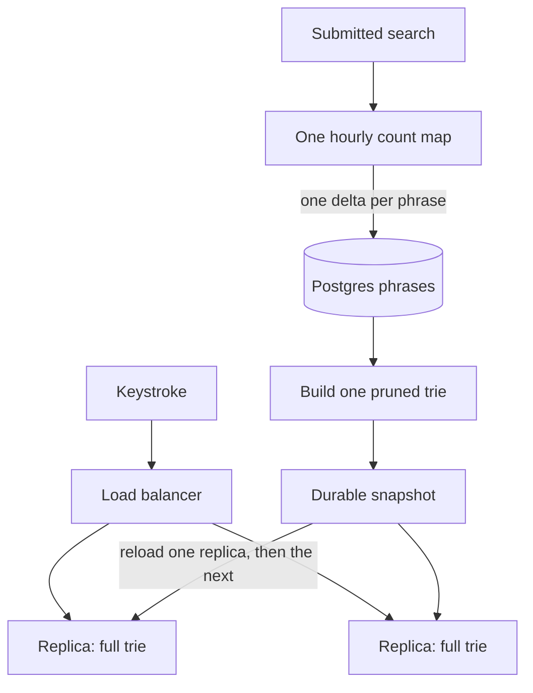
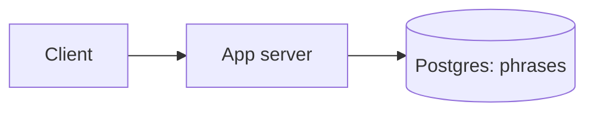

# Autocomplete system design — handoff

**Status: LOCKED. Current design is one pruned trie replicated on every server. Alphabet sharding from Deep dives 3 and 4 is superseded.**

**Do not update this file without Nabajyoti’s explicit permission.** That includes edits, rewrites, appends, renames, and deletion. Reading it and continuing the interview in chat are allowed. New decisions stay in the conversation until Nabajyoti asks for this file to be updated.

Interview target: Senior Software Engineer, LinkedIn-style, 45 minutes. Hello Interview progression: naive, then better, then interview-ready. One step at a time. Do not dump the full design.

---

## Where we are

| Phase | Step | State |
| --- | --- | --- |
| 0 | Understand the question | Locked |
| 1 | Functional requirements | Locked |
| 1 | Non-functional requirements | Locked. Freshness revised in Deep dive 2. |
| 1 | Core entities | Locked |
| 1 | APIs | Locked. Write behavior revised in Deep dive 2. |
| 2 | Basic working system | Locked |
| 3 | Deep-dive shortlist | Locked |
| 3 | Deep dive 1 — read path under 50 ms | Locked |
| 3 | Deep dive 2 — freshness about one hour | Locked |
| 3 | Deep dive 3 — index does not fit on one machine | Superseded. History only. |
| 3 | Deep dive 4 — suggestions fail open | Superseded. History only. Availability now uses full replicas. |
| 3 | Revision — full trie on every server | Locked. This is the current design. |

**Next chat step:** No required deep dive remains. Spelling, personalization, and languages are optional follow-ups, only if Nabajyoti asks. `next` alone does not start one. Do not revive alphabet sharding.

---

## Current design

One trie, copied onto every server. Keystrokes never touch Postgres or the snapshot store. Submits never touch the live trie. There is no prefix shard, no range map, and no parent-prefix cache.



- A load balancer sends the keystroke to a replica that is up. That replica walks its in-memory trie and returns the 10 phrase IDs stored on the node, then the display strings. `a`, `app`, and `lin` all hit the same full trie. If the replica does not answer in about 10 ms, the balancer uses another replica.
- If every replica is down, the prefix returns an empty list. Search still works.
- `POST /searches` adds 1 to one in-memory map for the current hour and returns `202`. A counter crash leaves the tries serving and drops the open hour.
- Once an hour, swap the map aside and flush one delta per phrase into Postgres. The build keeps phrases above a minimum search count and below a length cap, streams them most popular first, and stores each phrase once. Trie nodes hold phrase IDs, about 4 bytes each, not copies of the strings.
- Publish one snapshot. Reload one replica, and reload the next only after the first is healthy on the new build. A failed build leaves the previous trie in place.
- Postgres is the source of truth for popularity. Snapshot storage is how replicas load a build. Serving stays in memory. If Postgres is down, the dropdown keeps reading memory and the flush retries.
- Nabajyoti’s size estimate, not a measurement: about **1–50 million** served phrases and about **1–10 GB**. At 100,000 keystrokes per second and tens of thousands per node, a handful of replicas is enough. Child pointers can still make a trie larger than the ID table, so measure the built snapshot.

**Fallback, only if a measured snapshot does not fit on one machine.** Keep prefix-range sharding so a keystroke hits one shard. Cut points come from the build’s size and traffic, for example `a–ap` and `ap–b`, and the router rebuilds that small range map with the snapshot. Hashing the prefix scatters `lin` away from the phrases that continue it. A prefix that crosses a cut still spans two ranges: `ap` can sit on one shard, and `a` covers both.

---

## Question, in plain language

Someone is typing in a search box. After each character, return the **10 best completions**, fast enough to feel instant, and keep that list current as what people search for changes.

Example: prefix `lin` can return `linkedin`, `linkedin jobs`, `linkedin learning`.

**In scope:** a suggestion service. A prefix comes in, ten ranked phrases come out. The service also absorbs updates when phrases are added or their popularity changes.

**Outside this design:** the search box UI, running the actual search, ranking documents, ads, and accounts. Those systems call us or send us signals.

**Central challenge:** every keystroke is a query, so the read must be cheap, while “best” changes over time. The problem is **prefix → top 10, fast, on data that keeps changing.** After pruning, the served trie is expected to fit on one machine and is replicated. The raw log is still large.

This is a low-latency prefix-ranking service, not a general search engine.

---

## Locked functional requirements

1. **Prefix completions.** As someone types, return up to 10 phrases that start with the text so far. An empty box returns nothing.
2. **Ranked by global popularity.** The 10 are the most-searched matching phrases, most popular first. The same prefix returns the same list for everyone.
3. **Learn from real searches.** When someone submits a search, that phrase’s popularity goes up on the hourly flush. It enters the served trie only after it clears the minimum count and the length cap.

**Out of scope for the first design** (follow-ups only, not core requirements): spelling correction, personalized ranking, multiple languages, and the search results themselves.

---

## Locked non-functional requirements

Interview assumptions, not measurements.

1. **Latency.** Under **50 ms at p99**. Keystroke path. Rules out heavy work per character.
2. **Read volume.** About **100,000 suggestion requests per second at peak**. These are keystrokes on `GET /suggestions`. One server cannot absorb this.
3. **Submit volume.** About **10,000–20,000 submitted searches per second**. This is `POST /searches`, a smaller stream than keystrokes.
4. **Freshness.** About **1 hour**. Revised in Deep dive 2 from an earlier 1-minute assumption. Nabajyoti’s call: global popularity can lag by about an hour and the product still works. Counts do not need to be exact. A trend that must appear within a minute is not part of this design.
5. **Availability.** If suggestions fail, the search box still works and shows nothing. Target about **99.9%**. A missing dropdown is acceptable. A broken search is not.

**Scale assumption, revised.** The raw log can be on the order of **100 million** distinct phrases. The served index is smaller. Prune by minimum count and length. Nabajyoti’s estimate for what is served is roughly **1–50 million** phrases and about **1–10 GB**. That is not a measurement. Replicate the snapshot if it fits. Range-shard only if it does not.

---

## Locked core entities

The prefix index is a derived structure, not a third stored entity. Deep dive 1 locks how it is served. The hourly count map is process memory, not a stored entity.

### Phrase — one candidate suggestion

| Field | Purpose |
| --- | --- |
| `text` | Display string, e.g. `linkedin jobs` |
| `normalized` | Lowercased, trimmed match key, e.g. `linkedin jobs` |
| `popularity` | Search count. This is the rank. Updated by the hourly delta. |
| `updated_at` | When that count last changed. |

### Search event — one submitted search, not a keystroke

| Field | Purpose |
| --- | --- |
| `normalized` | Which phrase to credit |
| `timestamp` | When it was submitted |

A search event increments the in-memory hourly map. It is not a per-submit Postgres write. On the hourly flush, each phrase’s delta is added to `popularity` once. Raw events are not kept. Do not store keystrokes. Do not model users or documents in this version.

Example: `LinkedIn Jobs` increments the map entry `linkedin jobs` by 1. At the flush, Postgres applies that hour’s total delta for the phrase.

---

## Locked APIs

The server normalizes text. The client sends what the user typed.

### Suggest — every keystroke

`GET /suggestions?prefix=lin`

```json
{
  "suggestions": [
    { "text": "linkedin" },
    { "text": "linkedin jobs" },
    { "text": "linkedin learning" }
  ]
}
```

Most popular first, at most 10. The client needs the strings in order. `popularity` stays on the server. An empty `prefix` returns `{ "suggestions": [] }`. Served from the trie, not from Postgres.

### Record a search — on submit, not per character

`POST /searches`

```json
{ "text": "LinkedIn Jobs" }
```

Response: `202 Accepted`.

The server normalizes to `linkedin jobs` and adds 1 in the hourly count map. It does not update Postgres on this request. The client does not wait for the new ranking before showing search results.

---

## Locked basic architecture

Functionally correct for a small user base and low traffic. It does **not** meet the NFRs. That is expected. Later deep dives replace the read path and the write path. This section is the starting point, not the current design.

**Components:** one app server, one Postgres database.



Table `phrases`: `normalized` (primary key), `text`, `popularity`, `updated_at`.

**Suggest.** Lowercase the prefix, then:

```sql
SELECT text FROM phrases
WHERE normalized LIKE 'lin%'
ORDER BY popularity DESC
LIMIT 10;
```

**Record a search.** Normalize `LinkedIn Jobs` to `linkedin jobs`. If the row exists, add 1 to `popularity`. If not, insert it with popularity 1. Respond `202`. The next suggest call sees the new count.

**Known limitations of this basic system:**

- Each keystroke makes Postgres find every match and sort by popularity. That will not stay under 50 ms at 100 million phrases. **Addressed in Deep dive 1.**
- One app and one database cannot serve 100,000 requests per second, and a crash takes suggestions down. **Addressed by replicating the full trie. See the revision after Deep dive 4.**
- Every search updates one row. A phrase like `linkedin` becomes a write hotspot. **Addressed in Deep dive 2.**

---

## Locked deep dive 1 — read path under 50 ms

**Bottleneck.** Sorting every phrase that shares the prefix.

**Naive.** `LIKE 'prefix%' ORDER BY popularity DESC LIMIT 10` is correct while the match set is small. The index is ordered by spelling and the rank is ordered by popularity, so the limit does not stop the work early. Cost follows the number of matches. If 5 million phrases start with `a`, one keystroke reads and sorts those rows and already misses 50 ms.

**Decision.** An in-memory trie. Each node is one character and stores at most 10 phrases for that prefix. `GET /suggestions` walks one node per character and returns the stored list. Postgres remains the source of truth. This is the interview-ready read path. Do not add a search engine, a second cache, or a compressed trie to hit 50 ms.

**Build.**

- A keystroke does not build the trie.
- A builder streams phrases most popular first: `SELECT text, popularity FROM phrases ORDER BY popularity DESC`.
- For each phrase, walk its characters and create missing nodes. A node that already has 10 phrases does not take a less popular one. Deeper nodes are still created, so a rare phrase can appear once its prefix is specific enough. **The revision prunes phrases below a minimum count, so a one-off phrase is not suggested.**
- The serving process loads a finished trie at startup. When a new trie is ready, the server swaps to it. Deep dive 2 locks the trigger: build after the hourly flush commits.
- Reading about 100 million phrases is a heavy batch: minutes of work and a large memory footprint. Users do not wait for it. That duration fits the one-hour freshness target.
- The trie still has a path for every phrase, so one machine may not hold it. **Superseded.** The 200 GB figure was an inflated assumption. The revision prunes the catalog and stores phrase IDs, and expects the snapshot to fit.

**Failure handling.** If the trie is missing, or the prefix has no node, return an empty suggestion list. Search still works. If a build fails, keep serving the previous trie.

**Trade-off accepted.** The served list lags Postgres until the next finished snapshot is swapped in. Cadence is hourly.

**What to say.** “Suggestions come from an in-memory trie. Each node stores the top 10 phrases for that prefix. A keystroke walks those characters and returns the stored list. After the hourly count flush, a background build ranks phrases most-popular-first, and the server swaps in the finished trie. I accept that the list lags until that swap.”

---

## Locked deep dive 2 — freshness about one hour

**Bottleneck.** A `+1` on every submit. At 10–20k submits per second, a phrase like `linkedin` is one hot Postgres row. The dropdown also waited on a full trie rebuild, which takes several minutes.

**Requirement change.** Freshness is about one hour, not one minute. Nabajyoti set this: hourly popularity is enough for the product. The one-minute trend case is not designed.

**Naive.** Keep the trie, and increment Postgres on every submit. Rebuild the trie on a timer from a full scan. The dropdown reads the trie, so a spike such as `linkedin layoffs` at 12:00 stays invisible until the next build finishes, around 12:10. That misses a one-minute target. It also keeps the hot row.

**Decision.** Count submits in an in-memory map from phrase to count for the current hour. `POST /searches` only increments that map.

Once an hour:

1. Swap the map aside. New submits go into a fresh map.
2. Flush the snapshot: one `popularity = popularity + delta` per phrase. Insert the phrase if it is new.
3. Discard the snapshot only after Postgres commits. A failed flush retries the same deltas.
4. Run the Deep dive 1 trie build and swap the finished trie in.

Example: this hour `linkedin` was submitted 2 million times and `linkedin layoffs` 40,000 times. The flush is two row updates, then one rebuild. Typing `link` stays on the old trie until that swap.

**Failure handling.**

- A failed flush retries the same snapshot. The map is not cleared before commit.
- A failed trie build keeps the previous trie.
- If the process dies before the flush, that hour’s counts are lost. Ranking stays on the last good trie.

**Trade-off accepted.** A crash drops the open hour. The dropdown waits for the next successful swap, about an hour including the rebuild.

**What to say.** “Submits increment an in-memory map. Once an hour I flush one delta per phrase into Postgres, rebuild the trie, and swap it in. I drop a snapshot only after the commit. I accept that a crash loses the open hour, and that suggestions lag by about an hour.”

---

## Locked deep dive 3 — the index does not fit on one machine

**Superseded by the full-replica revision.** Kept so the path is visible. Do not present alphabet shards as the current design.

**Bottleneck.** One in-memory trie of about 200 GB cannot load on a 64 GB server. The process dies during the swap, so `lin` returns an empty list even though Postgres still has the phrases. The busiest first letters are also a large share of 100,000 keystrokes per second.

**Naive.** One server holds the whole trie and answers every prefix from it. A keystroke is a short walk and stays under 50 ms while the trie fits. At 100 million phrases it does not load.

**Decision.** Shard by prefix, and cache a parent prefix whose slices were split.

- Start with one trie per first letter. `lin` goes only to the L server, because every completion of `lin` starts with `l`.
- If a letter’s trie still does not fit, split it by one more character. Repeat until the slice fits. `ap` then lives on the `ap` server.
- The bare prefix `a` would have to ask every `a*` server. Its top 10 is ten strings and is fixed for the hour. The build fills that list in the same popularity-ordered pass, then publishes it. Do not merge each child’s stored 10: `apple` can sit just outside the `ap` list with a huge count, while `azure` leads a quiet child. A merge keeps `azure` and loses `apple`. Routers keep the published list in memory and answer `a` from there.
- The hourly count map stays one process. Submits do not go to the letter shards.
- After the flush commits, the build writes the slices into durable snapshot storage. A server loads only its slice, then serves it. Routers keep the previous parent list until every child slice for that build has loaded.
- A keystroke does not read Postgres, JSON, JSONB, or DynamoDB. Those stores are not the read path. A whole trie cannot be one JSON value or one DynamoDB item.

**Failure handling.**

- If a slice fails to build or fails to load, that server keeps the previous slice.
- If a slice is down, prefixes that live only there return an empty list. Search still works.
- The parent cache stays on the last fully loaded build, so `a` does not mix new and old children.

**Trade-off accepted.** The cached parent list lags until the next successful hourly swap. A single down `ap` server made `apple` empty at this stage. Deep dive 4 adds the second copy.

**What to say.** “I shard the trie by prefix so each machine holds a slice that fits. `lin` hits one shard. The hot prefix `a` is the top 10 from the hourly build, cached on the routers, so it does not fan out. A new build goes live after each slice has loaded. I accept hourly freshness, and an empty dropdown when a shard is down.”

---

## Locked deep dive 4 — suggestions fail open

**Superseded by the full-replica revision.** The availability idea that survives is multiple copies, reloaded one at a time, with failover inside 50 ms. Those copies now each hold the full trie, not a slice.

**Bottleneck.** Each slice had one server. One crash emptied every prefix on that slice, so the service missed 99.9%.

**Naive.** An empty list already protects search. A slice in memory keeps serving if Postgres or the snapshot store blips. A failed build keeps the previous slice. That is not enough: the `ap` server crashes at 12:10, `app` returns `{ "suggestions": [] }`, while `a` can still come from the cache. `apple` stays missing until a new process loads that slice.

**Decision.** Two copies of each slice, and two routers.

- Both copies load the same hourly snapshot. The router sends the prefix to a copy that is up, with about a 10 ms timeout before it tries the other. That also spreads keystrokes for a busy slice.
- A load balancer sends each keystroke to a router that is up. Both routers hold the hot-prefix lists.
- A new snapshot loads on one copy while the other keeps serving. The second copy loads only after the first is healthy on the new build.
- The counter stays one process. Its death does not blank the dropdown.
- If Postgres is down, serving continues from memory and the flush retries.

**Failure handling.**

- One copy down: the other answers inside the 50 ms budget.
- Both copies down: that prefix returns an empty list. Search still works.
- One router down: the load balancer uses the other.
- Counter crash: the open hour’s counts are lost. The last good tries stay up.
- A bad build stays off the second copy until the first copy is serving it.

**Trade-off accepted.** Serving costs about twice the machines. Suggestions for a prefix disappear only when every copy of its slice is down. A lost open hour on counter crash stays accepted.

**What to say.** “Each trie slice runs on two servers, and I put two routers in front. A keystroke tries one copy and falls over to the other inside the 50 ms budget. I reload one copy at a time. If every copy is down, I return no suggestions. I accept the extra machines, and I still accept losing the open hour if the counter crashes.”

**NFR check after this dive.** Latency, the one-hour freshness target, and the read and submit volumes are met on the healthy path. Availability is met for a single dead server. Spelling, personalization, and languages are not required by the locked NFRs.

---

## Revision — full trie on every server

Nabajyoti’s correction. This replaces Deep dives 3 and 4 as the design to defend.

**What was wrong.** The 200 GB trie was an assumption, and it forced alphabet sharding. A first-letter split is a teaching step. The split points in a real index come from the data. The long tail of one-off queries adds almost nothing to the top 10, and copying full strings onto every node inflates the snapshot.

**Decision.**

- Prune the catalog. Index phrases above a minimum search count and below a length cap. A rare phrase is never suggested, even when the user has typed almost all of it.
- Store each phrase once. Nodes hold phrase IDs, about 4 bytes each.
- Serve one in-memory trie on every replica. Scale reads by adding replicas. A handful of servers covers about 100,000 keystrokes per second.
- Reload one replica at a time. Fail over to another replica in about 10 ms. If every replica is down, return an empty list.
- Shard only when a measured snapshot does not fit. Use prefix ranges cut by size and traffic, such as `a–ap` and `ap–b`, and rebuild the range map with the hourly snapshot. Do not hash the prefix. A prefix that crosses a cut still spans more than one range.

**What to say.** “I prune the catalog and store phrase IDs, so the trie is a few gigabytes and fits on one machine. Every server holds the full snapshot, and I add replicas for traffic and for a dead node. I reload one replica at a time. I would range-shard from the measured data only if that snapshot stopped fitting. I accept that a rare phrase is never suggested.”

---

## Not decided yet

**Chosen. Do not reopen unless Nabajyoti asks.**

- Read path: in-memory trie with precomputed top 10. A search engine is not on the keystroke path.
- Rank ahead of time. Do not rank dynamically per request.
- Serve the trie from memory. A disk lookup is not the read path.
- Change the served trie by swapping snapshots. Do not edit the live trie on each search.
- Freshness target: about one hour.
- Write path: in-memory hourly counts, then one delta per phrase into Postgres, then rebuild and swap.
- A lost open hour on crash is accepted.
- Snapshot storage is for publishing and loading a build. It is not on the keystroke path.
- The hourly count map stays on one process.
- The served trie is pruned by minimum count and length, stores phrase IDs, and is replicated in full on every server. Alphabet shards and the parent-prefix cache are not in the current design.
- Reload one replica at a time. Fail over in about 10 ms. An empty list happens only when every replica is down.
- Data-driven prefix ranges are the fallback if a measured snapshot does not fit. Hashing the prefix is rejected. A prefix that crosses a cut spans ranges.

**Still open**

- Global popularity versus personalized ranking.
- Spelling correction and multiple languages.
- A trend that must show up within a minute. Out of the locked design.

**Follow-ups**

1. Under 50 ms — **answered in Deep dive 1.**
2. Spelling mistakes — open.
3. Trending terms every minute — **not in this design.** Freshness is about one hour.
4. Multiple languages — open.
5. Shard the prefix index — **revised.** Do not shard while the snapshot fits. If it does not, cut prefix ranges from size and traffic. Do not hash the prefix.
6. Extremely popular prefixes like `a` — **revised.** Every replica holds the full trie, so `a` is the top 10 already stored on that node.

**Key insight, now locked:** prune and store phrase IDs, measure the snapshot, and replicate the whole trie when it fits. Range-shard only if it does not. Alphabet sharding and the 200 GB assumption are not the design to defend.

---

## How to resume coaching

- Start from the current design. Deep dives 1 and 2 still stand. Deep dives 3 and 4 are history. Do not re-open the one-hour freshness target, the full-replica revision, or the prune trade-off unless Nabajyoti asks to change one.
- The required design is complete. Do not add a deep dive unless Nabajyoti asks for an optional follow-up. Do not put alphabet shards back into the answer.
- Commands: `next` moves exactly one step. `deeper`, `simplify`, `why`, `alternatives`, `interview answer`, `recap`, `big picture`, `skip`, and `challenge me` keep their original meanings.
- Keep coaching replies about 150–250 words, one or two new concepts at a time, then stop.
- About **1–2 new technical concepts per deep-dive response**.
- Do not write later decisions into this file unless Nabajyoti explicitly allows an update.
