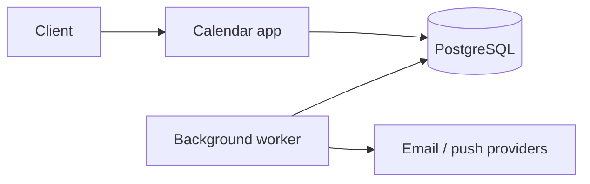
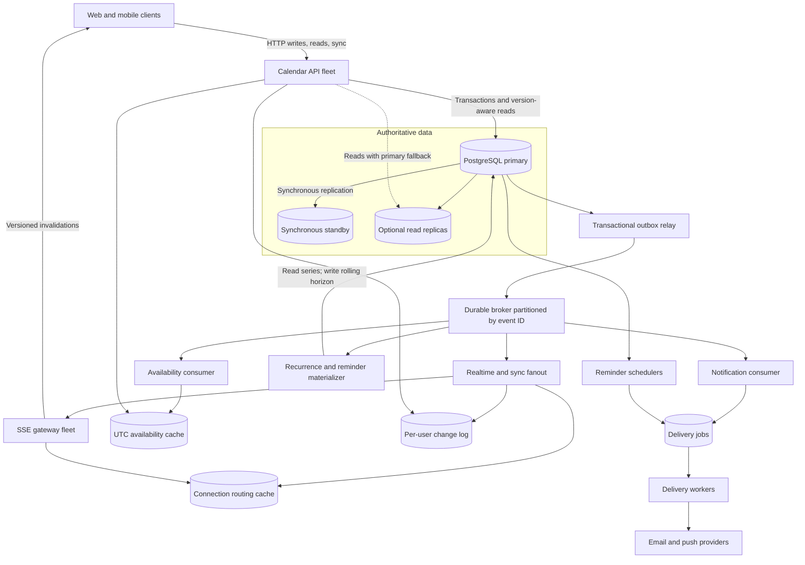

# Calendar system design — handoff

**Status: LOCKED and complete through all four planned deep dives, review corrections, and the final architecture.**

**Do not edit, append, rewrite, rename, or delete this file unless Nabajyoti explicitly gives permission in the current request to update this handoff.** Reading it and continuing the interview in chat are allowed. New decisions remain in the conversation until Nabajyoti gives that permission.

Interview target: Senior Software Engineer, LinkedIn-style, 45 minutes. Use a Hello Interview progression: naive, then better, then interview-ready. Proceed one step at a time and do not dump the complete design.

---

## Where we are

| Phase | Step | State |
| --- | --- | --- |
| 0 | Understand the question | Locked |
| 1 | Functional requirements | Locked |
| 1 | Non-functional requirements | Locked |
| 1 | Core entities | Locked |
| 1 | APIs | Locked |
| 2 | Basic working system | Locked |
| 3 | Deep-dive shortlist | Locked |
| 3 | Deep dive 1 — free/busy and conflict detection | Locked |
| 3 | Deep dive 2 — real-time updates across devices | Locked |
| 3 | Deep dive 3 — reliable, idempotent invitations | Locked |
| 3 | Deep dive 4 — recurring events, time zones, and DST | Locked |
| Final | Review corrections and overall architecture | Locked |

**Next chat step:** No required deep dive remains. Continue only with a recap, interview practice, or an optional follow-up that Nabajyoti requests.

---

## Coaching rules

- Never give the complete design in one response.
- Move exactly one step when Nabajyoti says `next`.
- Keep replies concise, normally about 150–250 words.
- Introduce at most one or two new technical concepts per deep-dive response.
- Evolve the same system: naive → better → interview-ready.
- For every improvement, state the current problem, why it matters, the simplest fix, and the trade-off.
- Optimize for a defensible Senior SWE design in a 45-minute interview, not maximum sophistication.
- If Nabajyoti asks a question, answer only that question and do not advance automatically.

Commands retain their agreed meanings: `next`, `deeper`, `simplify`, `why`, `alternatives`, `interview answer`, `recap`, `big picture`, `skip`, and `challenge me`.

---

## Question in plain language

Design the backend of a shared calendar system. It keeps one meeting synchronized across multiple participants' calendars while supporting changes, repeating schedules, different time zones, availability checks, invitations, and reminders.

### System boundary

The calendar service owns events, attendee state, recurrence, availability, and reminder scheduling. Email and push providers are external delivery systems.

Calendar UI, identity management, video conferencing, and email-provider internals are outside the initial design unless the interviewer asks.

### Central engineering challenge

A meeting is not merely a private calendar entry. It has shared event data, such as time and recurrence, plus participant-specific state, such as RSVP status or whether a participant removed it from their own calendar. Concurrent edits and asynchronous notifications must not make participants observe contradictory event versions.

Normal user events may overlap because availability is advisory. Exclusive resources such as meeting rooms require a separate, strict no-double-booking guarantee.

**Key insight:** build a consistent shared event model, while treating availability, recurrence expansion, and notification delivery as supporting concerns with different consistency needs.

---

## Locked functional requirements

1. **Manage events.** Users can create, view, edit, and delete one-time or recurring events, including title, time, location, and time zone.
2. **Invite participants and manage responses.** Organizers can invite internal or external participants. Invitees can accept, decline, or mark themselves tentative.
3. **View calendars and availability.** Users can view their calendar and check permitted free/busy information for participants when scheduling.
4. **Receive invitations and reminders.** The system sends invitation updates and scheduled reminders through channels such as email or push notifications.

### Out of scope for the initial design

- Calendar sharing permissions
- Meeting-room booking guarantees
- Video-conference creation
- Tasks
- Sophisticated scheduling recommendations

Room booking is a follow-up because it requires stronger consistency than ordinary availability.

---

## Locked non-functional requirements

These are interview assumptions, not measured product numbers.

1. **Scale.** Roughly 10 million daily active users and 10 million event changes per day: about 115 writes per second on average and roughly 1,200 per second at a 10-times peak. Assume 10% of DAU are concurrently active with two devices each, or about 2 million live connections. Reads, fanout, and persistent connections—not event writes—are the dominant scaling pressure.
2. **Latency.** Calendar reads and event mutations complete within 200 ms at p99. A free/busy query for up to 20 participants completes within 500 ms at p99.
3. **Availability and durability.** Core calendar operations target 99.99% availability. PostgreSQL runs with a synchronous in-region standby and automated failover, so an acknowledged event update survives a primary failure. A temporarily unavailable notification provider must not block the event update.
4. **Consistency.** Organizer-controlled event details and each attendee's state use separate optimistic-concurrency versions. Participant views and availability caches may converge within a few seconds. Authoritative reads that require a minimum version use the primary or fall back to it when a read replica is behind. Exclusive resource booking, if added, must prevent double-booking.

Invitation and reminder delivery is at least once, with duplicates safely suppressed.

**Key decision:** preserve durable, ordered event updates; allow derived views and notifications to catch up asynchronously.

---

## Locked core entities

### Event

The authoritative meeting or recurring series.

- `event_id`
- `organizer_id`
- `title`, `location`
- `start_local`, `end_local`, `time_zone`
- `recurrence_rule`, `event_version`

`event_version` changes only when the organizer modifies shared event definition data, including attendee membership. RSVP changes do not increment it.

### Attendee

A participant's relationship to an event.

- `event_id`
- `user_id` or external email
- `response`: pending, accepted, tentative, or declined
- `visibility`: active or removed from own calendar
- `attendee_version`, `response_updated_at`

Each attendee row has independent optimistic concurrency. Updating one RSVP does not conflict with organizer edits or other attendees.

Removing an invitation locally does not delete the organizer's event.

### Recurrence Exception

Changes one occurrence without modifying the entire series.

- `event_id`
- `original_start_local`, which identifies the occurrence
- `override_start`, `override_end`
- `override_details`
- `status`: modified or cancelled

### Reminder

Describes when and how a participant should be notified.

- `reminder_id`
- `event_id`, `recipient_id`
- `fire_at_utc`, derived from the occurrence and offset
- `channel`
- `series_version`, `status`

Availability is a derived view of events and attendee state, not a source of truth.

**Key decision:** represent a recurring meeting as one event series plus exceptions rather than permanently storing every future occurrence.

---

## Locked APIs

### Create an event

`POST /events`

Request contains title, local start/end, IANA time zone, recurrence rule, attendees, and reminders.

Response contains `event_id`, `event_version`, and the normalized schedule. Adding attendees triggers invitations asynchronously.

### Update or delete an event

`PATCH /events/{event_id}`

`DELETE /events/{event_id}`

Request contains:

- `expected_event_version`
- Changed fields
- `scope`: `series`, `occurrence`, or `this_and_following`
- `occurrence_start` when changing one occurrence

The response returns the new `event_version`. A stale `expected_event_version` produces a conflict instead of overwriting another organizer edit.

For `this_and_following`, truncate the old series with `UNTIL` immediately before the selected occurrence and create a new series beginning there. Past exceptions remain with the old series. Future exceptions move only when their original recurrence identity still maps to an occurrence in the new series; unmatched exceptions require explicit review rather than silent reassignment.

### Respond to an invitation

`PUT /events/{event_id}/attendees/me`

Request contains `response` and `expected_attendee_version`.

Response contains the updated attendee state and `attendee_version`. It does not modify `event_version`.

### Fetch an authoritative event

`GET /events/{event_id}?min_event_version=...`

The API may read from a replica when it has reached the requested version. Otherwise it waits briefly or falls back to the primary, preventing an SSE invalidation for version 8 from being followed by a stale version 7 read.

### View calendar events

`GET /calendars/{user_id}/events?start=...&end=...`

Response contains expanded occurrences in the requested range, including event ID, occurrence start/end, title, and RSVP state.

### Synchronize a reconnecting client

`GET /sync?token=...`

Response contains authorized event and attendee changes since the opaque token plus a new token. The token is backed by a durable per-user change log.

### Receive live invalidations

`GET /events/stream`

This is an SSE endpoint. The client sends `Last-Event-ID` when reconnecting, then uses the sync endpoint whenever replay is unavailable or the gateway returns `resync required`.

### Respond as an external attendee

`POST /external-invitations/{signed_token}/response`

The signed, expiring token identifies the invitation and permitted response without requiring an internal account. Processing inbound iTIP `REPLY` email is an optional interoperability path.

### Query availability

`POST /availability/query`

Request contains participant IDs and a time range.

Response contains busy intervals and their status—busy or tentative—per participant, subject to calendar permissions. Declined and explicitly free events do not block availability.

**Key decisions:** organizer edits and attendee responses have separate versions; recurrence expansion is bounded by the requested range; reconnect and SSE paths share durable synchronization semantics.

---

## Locked basic working system

This is functionally correct for a small user base and low traffic. It is intentionally not the final scalable architecture.

### Components

- One calendar application server
- One PostgreSQL database
- A background worker in the same application deployment
- External email and push providers



### Request flows

1. **Create or edit an event.** The app transactionally writes the event, attendees, exceptions, reminders, and one event-change outbox record. An organizer update succeeds only when `expected_event_version` matches, then increments `event_version`.
2. **View a calendar.** The app queries relevant one-time events and recurring series. It expands recurrence rules only for the requested date range and applies occurrence exceptions.
3. **Check availability.** The app queries each participant's events, expands relevant recurrences, and merges overlapping busy intervals. This is computed directly from authoritative data.
4. **RSVP and notifications.** An RSVP independently updates `attendee_version` and writes an outbox record. A notification consumer creates durable delivery jobs; workers call external providers and retry failures.

PostgreSQL is the source of truth, including pending notification work. This prevents an event update from committing while silently losing its invitation.

### Known limitations

- Availability queries repeatedly expand and merge many users' events.
- One application server and one database limit throughput and availability.
- Polling and recurrence expansion become expensive at scale.
- Participant views may not update in real time across devices.

---

## Locked deep-dive shortlist

Ranked by importance to this design, interview likelihood, and impact on the NFRs:

1. **Free/busy and conflict detection at scale.** How will we compute and serve free/busy and detect conflicts quickly as the number of calendars and participants grows?
2. **Real-time updates across devices.** How will we deliver event edits and RSVP changes with low latency without overloading servers?
3. **Reliable, idempotent invitations.** How will we make the invitation workflow reliable across email, push notifications, and retries without harmful duplicates?
4. **Recurring events, time zones, and daylight saving time.** How will we prevent incorrect event times and broken reminders?

Do not start all four. Nabajyoti chooses one, then it progresses through the following levels one at a time.

### Required structure for each deep dive

#### Level 1: Naive solution

- Explain how the basic architecture handles it.
- State what works and where it fails.
- Give one concrete failure example.
- Stop and wait.

#### Level 2: Better solution

- Introduce the simplest meaningful improvement.
- Explain the intuition and specific architecture change.
- State which limitation it resolves and its main trade-off.
- Stop and wait.

#### Level 3: Interview-ready solution

- Decide whether Level 2 already satisfies the NFRs.
- Add another improvement only if justified.
- Cover only the failure handling and trade-offs that matter.
- Give the concise explanation Nabajyoti should use in the interview.
- Stop and wait.

After a deep dive, recap the original bottleneck, final decision, reason, and accepted trade-off. Then return to the remaining shortlist.

---

## Locked Deep Dive 1 — free/busy and conflict detection at scale

### Level 1: Naive solution

For every availability request, the application:

1. Queries PostgreSQL for each participant's events in the requested time range.
2. Expands recurring series in that range.
3. Applies cancelled and modified occurrences.
4. Merges overlapping events into busy intervals.
5. Reports a conflict when a proposed time overlaps a busy interval.

This is functionally correct and reads authoritative event data. It works for a small number of calendars and short ranges.

It fails at scale because every request repeats the same database reads and recurrence expansion. For example, checking a 30-day window for 20 participants might process 10,000 event and recurrence records. Concurrent scheduling requests can overload PostgreSQL and exceed the 500 ms p99 target.

Conflict detection for user calendars remains advisory: overlapping events are reported, not rejected.

### Level 2: Availability cache

Cache each user's merged busy intervals in UTC-day buckets. A key such as `availability:user-123:2026-10-23Z` contains that user's intervals and busy/tentative status for one UTC day. Clip these intervals to the caller's requested time zone and range at read time.

For an availability query:

1. Fetch the required user-day buckets.
2. Return precomputed intervals for cache hits.
3. For a miss, read events from PostgreSQL, expand recurrences, merge the intervals, and fill the cache.
4. Combine the daily buckets to find common free time.

When an event changes, invalidate the affected participants' UTC-date buckets. A short TTL provides recovery if invalidation fails. Materialize only the same rolling horizon used by recurrence processing—for example, 90 days—and compute ranges beyond it on demand.

This avoids repeatedly reading and expanding the same events. Cache individual user-day results rather than complete multi-user queries because a user's intervals are reusable across many participant combinations.

**Trade-off:** invalidation adds complexity, and availability may briefly be stale. A few seconds of staleness is allowed by the NFR.

### Level 3: Availability consumer

Best-effort invalidation alone is fragile: a server can commit an event update and crash before invalidating the cache.

In the same PostgreSQL transaction as an event or attendee update, write one event-change record to the shared transactional outbox. The availability consumer reads that stream and creates bounded refresh work only for affected participants and UTC days inside the rolling horizon. A worker:

1. Reads committed refresh jobs.
2. Recomputes the user-day busy intervals.
3. Writes the bucket to the availability cache.
4. Marks the job complete.

Refresh work carries the source `event_version`, `attendee_version`, and change sequence as applicable. Retried work is idempotent, and an older refresh cannot overwrite a bucket produced from newer source state. On a cache miss or a query beyond the materialized horizon, the API computes intervals from authoritative PostgreSQL data and fills the cache when appropriate.

Availability can remain stale for a few seconds while workers catch up, which matches the NFR. The availability cache must not enforce exclusive meeting-room booking because stale data could admit two reservations.

### Interview answer

> "I cache busy and tentative intervals by user and UTC day so different participant combinations reuse the same data. Event and RSVP changes enter one transactional outbox, and an availability consumer refreshes affected buckets inside a rolling horizon. Refreshes are versioned and idempotent; misses and farther ranges fall back to authoritative event data. I accept a few seconds of staleness because free/busy is advisory."

### Recap

- **Original bottleneck:** repeated database reads and recurrence expansion
- **Final decision:** asynchronously refreshed UTC user-day availability buckets with busy status and a bounded horizon
- **Why:** reusable computation keeps free/busy queries within the latency target and reduces database load
- **Accepted trade-off:** bounded stale availability and additional cache/worker complexity

---

## Locked Deep Dive 2 — real-time updates across devices

### Level 1: Naive polling

Every active device periodically calls the calendar API, perhaps every five seconds, to fetch events changed since its last known version. Event edits and RSVP changes are stored in PostgreSQL, and devices observe them on their next poll.

This is simple, survives temporary network loss, and can use event versions to ignore old updates. However, it creates traffic even when nothing has changed.

With 10% of 10 million DAU concurrently active and two devices per user, there are about 2 million active clients. At a five-second polling interval, the service still receives roughly 400,000 requests per second. Most responses report no changes. Increasing the interval lowers load but makes updates feel delayed.

**Bottleneck:** polling ties server load to the number of connected devices rather than the smaller number of actual calendar changes.

### Level 2: Server-Sent Events

Use Server-Sent Events (SSE), not WebSockets, for active clients. Calendar writes continue to use normal HTTP requests; the real-time channel only carries server-to-client updates, so bidirectional WebSocket communication is unnecessary.

SSE also supports automatic reconnection and `Last-Event-ID`. WebSockets would become justified only if the product added bidirectional features such as collaborative editing or presence.

The application maintains an in-memory mapping:

`user_id → active device connections`

After an event edit or RSVP transaction commits, the server sends each affected connection a small invalidation:

```json
{
  "event_id": "evt-123",
  "event_version": 8,
  "attendee_version": null,
  "sync_sequence": "opaque-456",
  "change": "updated"
}
```

The client then fetches the latest authorized state through the normal API. Organizer changes carry `event_version`; RSVP or visibility changes carry the relevant `attendee_version`. Every user-facing change also has an opaque sync sequence. A delayed invalidation cannot overwrite newer client state.

#### Determining affected recipients

The server derives recipients from authoritative event and attendee data, never from recipient IDs supplied by the caller.

- A time, title, or location change affects the organizer and all internal attendees.
- Adding an attendee affects the organizer, existing attendees, and the new attendee.
- Removing an attendee also includes that removed attendee so their devices delete the event.
- An RSVP change affects the responder and organizer. It also affects all attendees when RSVP status is visible to them, but it increments only that attendee's version—not `event_version`.
- Removing an event only from one participant's calendar affects that participant's devices.
- External email attendees have no SSE connection; the invitation workflow handles them.

This removes wasteful polling, but one server's in-memory connection map cannot locate devices attached to other servers.

**Trade-off:** persistent connections consume server resources and require reconnection handling.

### Level 3: Interview-ready SSE delivery

The final architecture distributes active connections across an SSE gateway tier and makes update publication durable:

1. In the same PostgreSQL transaction as the mutation, write one event-change outbox record containing the event ID, applicable resource versions, change type, and enough recipient information to derive affected users.
2. An outbox relay publishes committed records to a durable broker partitioned by `event_id`, preserving per-event order.
3. Each device connects to an SSE gateway. The gateway registers its active users in a routing cache as `user_id → gateway IDs`.
4. A fanout worker pages attendee membership and routes each affected user's invalidation. For a large event—for example, more than 1,000 attendees—it processes recipients in chunks instead of creating one huge outbox payload or transaction.
5. Each gateway pushes the invalidation to all locally connected devices for that user.

At roughly 2 million concurrent connections and an illustrative 50,000 connections per gateway, the tier needs about 40 gateways before headroom and redundancy.

The real-time message is only an invalidation. PostgreSQL and the normal event API remain authoritative.

#### Failure handling

- At-least-once delivery can create duplicates; clients ignore versions they already have.
- If a gateway dies, clients reconnect to another gateway and register there.
- After reconnecting, a client performs a delta sync using its last sync token, so a missed SSE message does not create permanent inconsistency.
- After receiving an organizer edit, the client requests `min_event_version`. A stale read replica waits or falls back to the primary.
- A slow client receives a `resync required` signal instead of accumulating an unbounded backlog.
- If the direct real-time path is temporarily unavailable, committed event data remains safe and clients recover through synchronization.

### Interview answer

> "I use SSE because calendar updates are one-way; writes still use HTTP. Each mutation writes one transactional outbox record. A relay and fanout worker route resource-versioned invalidations through an event-keyed broker to the SSE gateways holding affected users' connections. Clients request at least the advertised version, and reconnecting clients perform a delta sync. This gives low latency without making SSE the source of truth."

### Recap

- **Original bottleneck:** frequent client polling generated traffic even when nothing changed
- **Final decision:** versioned invalidations delivered through an outbox, broker, and SSE gateway tier
- **Why:** server load follows actual event changes while committed updates remain recoverable
- **Accepted trade-off:** additional broker, routing-cache, fanout, and gateway infrastructure

---

## Locked Deep Dive 3 — reliable, idempotent invitations

### Level 1: Naive durable jobs

The basic system stores a notification job in PostgreSQL in the same transaction as the event update. A worker polls pending jobs, calls the email or push provider, marks successful jobs delivered, and retries failures.

This prevents an application crash or provider outage from silently losing an invitation. However, our database update and the external provider call cannot be one atomic transaction.

Concrete failure:

1. The worker asks the provider to send invitation version 5.
2. The provider sends it successfully.
3. The worker crashes before marking the job delivered.
4. Another worker finds the pending job and sends it again.

Durable jobs therefore provide at-least-once processing but leave an uncertainty window that can produce duplicate invitations.

### Separate in-app synchronization from external delivery

Sync tokens plus SSE solve freshness for authenticated internal clients:

1. A reconnecting client presents its last sync token.
2. The server returns missed event versions.
3. SSE continues delivering new invalidations.

Use sequence numbers or one ordered stream so an update cannot be lost between catch-up and establishing SSE.

This does not replace invitation delivery. An external attendee may only have an email address, a mobile app may be suspended, and a reminder delivered only after reconnection may be too late.

### Interview-ready solution: stable delivery identity

Each logical delivery gets a deterministic identity. Organizer-controlled invitation updates use:

`delivery_id = event_id + attendee_id + event_version + notification_type + channel`

An RSVP notification uses that attendee's `attendee_version` instead of `event_version`. The database enforces uniqueness on `delivery_id`, preventing duplicate jobs for the same logical update.

Delivery flow:

1. The event or attendee transaction writes one shared event-change outbox record.
2. The notification consumer idempotently creates the uniquely keyed delivery job.
3. A worker claims the delivery job and sends it using `delivery_id` as the provider idempotency key.
4. Failures use bounded exponential-backoff retries—for example, five attempts—with the same key.
5. After the retry limit, the job moves to a failed state for inspection or later replay.

The email or push payload also carries the stable `event_id`, applicable resource version, notification type, and `delivery_id`. Receiving calendar clients ignore a `delivery_id` they have already processed and reject resource versions older than their current version.

For calendar email, use a stable iCalendar `UID` and an increasing `SEQUENCE`, so retries represent the same logical update and newer event versions supersede older ones.

External attendees can respond through a signed, expiring RSVP link. Processing inbound iTIP `REPLY` email is optional interoperability, not required for the core workflow.

If the provider supports idempotency, repeated calls with the same key produce one external delivery. If it does not, exactly-once physical delivery is impossible. The defensible guarantee is at-least-once transport with idempotent logical processing; a recipient might still see a duplicate email.

This solution is interview-ready for the stated NFRs. More infrastructure is not justified.

### Interview answer

> "Each event or RSVP mutation writes one transactional outbox record, and the notification consumer creates a uniquely keyed delivery job. Organizer invitations use event version; RSVP notifications use attendee version. Workers retry with exponential backoff using the same delivery ID as the provider idempotency key. Payloads carry stable IDs and versions, allowing recipients to deduplicate retries and reject stale updates. I guarantee at-least-once delivery with idempotent processing, not impossible exactly-once delivery across an external provider."

### Recap

- **Original problem:** a provider can deliver successfully even when our worker never records its acknowledgement
- **Final decision:** durable invitation jobs with deterministic delivery IDs and versioned payloads
- **Why:** retries preserve one logical identity, enabling provider and recipient deduplication
- **Accepted trade-off:** providers without idempotency support can still produce a duplicate physical email

---

## Locked Deep Dive 4 — recurring events, time zones, and daylight saving time

### Level 1: Naive fixed-UTC recurrence

The naive implementation converts the first occurrence to UTC and generates later occurrences by adding a fixed interval. A weekly recurrence becomes:

`next occurrence = previous UTC timestamp + 7 × 24 hours`

This works for one-time events, UTC recurrences, and zones whose offset does not change during the series. It fails when a recurrence represents a local wall-clock intention.

For example, a weekly 9:00 AM New York meeting is 14:00 UTC before daylight saving begins. Adding exactly seven days keeps the next occurrence at 14:00 UTC, but after the offset change that is 10:00 AM in New York. The meeting and reminder appear one hour late.

Storing only a fixed offset such as `UTC-5` has the same problem because New York later changes to `UTC-4`.

The event model already stores local time and an IANA zone. The naive failure is converting once and then treating the recurring series as fixed UTC timestamps.

### Level 2: Expand in local time

Preserve the organizer's wall-clock intention by storing values such as:

```text
start_local: 2026-03-02 09:00
time_zone: America/New_York
recurrence_rule: FREQ=WEEKLY;BYDAY=MO
```

Use an IANA time-zone identifier rather than a fixed offset because it contains historical and future offset rules.

For a requested range:

1. Apply the recurrence rule to generate local dates and times.
2. For each local occurrence, consult the time-zone database for the applicable offset on that date.
3. Convert that occurrence to UTC for comparison, indexing, and delivery.
4. Apply exceptions using the occurrence's original local start as its identity.
5. Calculate reminders from the resolved UTC occurrence.

The meeting remains at 9:00 AM New York time while its UTC representation changes from 14:00 before DST to 13:00 after DST.

One exception can modify or cancel a single occurrence without copying the entire series.

**Trade-off:** local expansion requires time-zone database lookups and more computation than fixed-duration arithmetic. Government rule changes can also alter future UTC conversions.

### Level 3: Explicit DST policies and bounded materialization

Some local times are invalid or ambiguous, so the product needs deterministic policies:

- During spring-forward, a local time such as `02:30` may not exist. The chosen default is to shift it forward by the DST gap to `03:30`.
- During fall-back, a local time such as `01:30` occurs twice. Choose the earlier offset by default and store the selected offset when explicitly overridden.

The exact policy is product-specific; consistency and documentation matter more than the particular choice.

Keep the recurrence rule and exceptions as the source of truth. Materialize derived occurrences only for a rolling near-term horizon—for example, 90 days—for availability and reminders. A background worker extends that window.

When the series, an exception, or time-zone rules change, regenerate only future derived occurrences. Reminder jobs carry the series version, so an obsolete generated job cannot send after the series changes. Do not materialize an infinite recurrence.

### Reminder scheduling at scale

Each materialized reminder has an indexed `fire_at_utc`. Sharded scheduler workers scan short due-time windows—such as one minute—and atomically claim rows before enqueueing delivery jobs. Partitioning the due work provides capacity for the large spikes around common meeting times without changing user-visible reminder times.

Before sending, the delivery worker checks the current event or series version and suppresses reminders for cancelled or superseded occurrences. Retries follow the same idempotent delivery workflow as invitations. A product-defined lateness grace period determines whether a delayed reminder is still useful; only reminders beyond that threshold are dropped.

### Interview answer

> "I store the local start, IANA time zone, recurrence rule, and exceptions. I generate each occurrence in local time before converting it independently to UTC. I define deterministic policies for nonexistent and ambiguous DST times. The series remains authoritative, while I materialize only a rolling near-term window. Indexed UTC fire times feed sharded reminder schedulers, and workers verify the current series version before sending."

### Recap

- **Original problem:** fixed UTC intervals shift the intended local meeting time across DST
- **Final decision:** local-time recurrence with explicit DST policies and bounded materialization
- **Why:** it preserves wall-clock intent while supporting efficient near-term availability and reminders
- **Accepted trade-off:** more expansion, regeneration, and time-zone-rule complexity

---

## Locked final architecture



### Main flow

1. The API transaction updates authoritative event or attendee rows and appends one outbox record atomically.
2. `event_version` orders organizer-controlled definition changes. Each attendee has an independent `attendee_version`. A sync sequence orders changes for a user's reconnect flow.
3. The outbox relay publishes to one durable event-keyed stream. Separate consumers maintain availability buckets, per-user sync and SSE fanout, durable notification jobs, and the rolling recurrence/reminder horizon.
4. Separate job tables remain intentional: availability refreshes, scheduled reminders, and provider deliveries have different scheduling and retry lifecycles even though they originate from one publication mechanism.
5. SSE is a low-latency hint. The sync API and authoritative version-aware reads repair missed messages.
6. Recurrence rules and exceptions remain authoritative. Only a rolling near-term window is materialized for availability and reminder scheduling.
7. PostgreSQL uses synchronous in-region replication and automated failover. Derived caches and projections can be rebuilt.

### Data placement and follow-up answers

- At the assumed peak of roughly 1,200 event changes per second, database sharding is not yet justified. Index attendee/calendar access by `user_id` and authoritative events by `event_id`. If sharding later becomes necessary, partition per-user calendar projections by `user_id` and event authority by `event_id`.
- Large events use chunked attendee fanout rather than embedding tens of thousands of recipients in one outbox row.
- Strict meeting-room booking never consults availability cache. Use one strongly consistent transaction and a PostgreSQL exclusion constraint over `room_id` and the reserved UTC time range.
- `this_and_following` splits the series; signed RSVP links handle external attendees. iTIP reply ingestion remains optional interoperability.

---

## Still open

- No required deep dive remains
- Optional follow-ups or interview practice only when Nabajyoti requests them
- Whether any later decision should be added to this handoff; this requires Nabajyoti's explicit permission in that request

