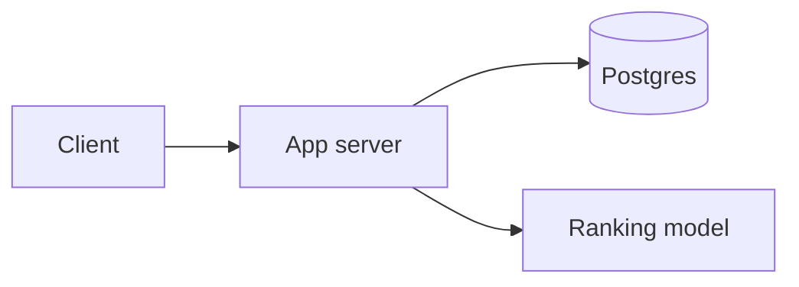

# Job recommendation system design — handoff

**Status: LOCKED through deep dive 4 (cold start and filter bubbles).**

**Do not edit, append, rewrite, rename, or delete this file unless Nabajyoti explicitly gives permission in the current request to update this handoff.** Reading it and continuing the interview in chat are allowed. New decisions stay in the conversation until Nabajyoti gives that permission.

Interview target: Senior Software Engineer, LinkedIn-style, 45 minutes. Nabajyoti is interviewing as a Senior SWE, not an ML engineer. Use a Hello Interview progression: naive, then better, then interview-ready. Proceed one step at a time and do not dump the complete design.

---

## Where we are

| Phase | Step | State |
| --- | --- | --- |
| 0 | Understand the question | Locked |
| 1 | Functional requirements | Locked |
| 1 | Non-functional requirements | Locked |
| 1 | Core entities | Locked |
| 1 | APIs | Locked |
| 2 | Basic working system | Locked |
| 3 | Deep-dive shortlist | Locked |
| 3 | Deep dive 1 — serving under 150 ms at peak QPS | Locked. Candidate lookup superseded by deep dive 2. |
| 3 | Deep dive 2 — candidate generation with filters and diversity | Locked |
| 3 | Deep dive 3 — freshness without retraining | Locked |
| 3 | Deep dive 4 — cold start and filter bubbles | Locked |

**Next chat step:** No required deep dive remains. Continue only with a recap, interview practice, or an optional follow-up that Nabajyoti requests. `next` alone does not open a new topic.

---

## Coaching rules

- Never give the complete design in one response.
- Move exactly one step when Nabajyoti says `next`.
- If Nabajyoti asks a question, answer only that question and do not advance automatically.
- Keep replies concise, normally about 150–250 words.
- Introduce at most one or two new technical concepts per deep-dive response.
- Evolve the same system: naive → better → interview-ready.
- For every improvement, state what is wrong, why it matters, the simplest fix, and the trade-off.
- Optimize for a defensible Senior SWE design in a 45-minute interview, not maximum sophistication.
- The ranking model is an input the service calls. Do not design the model, the training job, or the learning algorithm.
- Commands such as `next`, `recap`, `deeper`, or `interview answer` are not permission to modify this file.

Commands retain their agreed meanings: `next`, `deeper`, `simplify`, `why`, `alternatives`, `interview answer`, `recap`, `big picture`, `skip`, and `challenge me`.

---

## Question in plain language

Design the member-facing **Jobs for you** system. A member opens Jobs and sees a ranked list of open jobs chosen for them. They can filter that list and still keep a personal ranking. Save, dismiss, and hide change later results. Viewing a job, searching, or applying shifts the next list without a manual refresh and without retraining a model for that one action.

### System boundary

**In scope.** The online read path and the feedback path. A member, their recent behavior, and any filters go in. A ranked page of jobs comes out. Explicit feedback and recent activity are stored so the next read sees them.

**Given, not designed.** A ranking model already exists. Job postings and member profile data already exist.

**Out of scope.** Ranking-model design and training, the apply flow, recruiter candidate search, and creating or editing job postings.

### Central engineering challenge

Personalization, filters, and freshness all land on the read path, and that read has to stay around **150 ms at the tail** under peak traffic. Scoring every active job on the request, or retraining on every click, fails that bar.

The serving system is what a Senior SWE defends. The model is called, not invented.

---

## Locked functional requirements

1. **Personalized ranked jobs.** A member opens Jobs and sees open roles ordered for their profile and context: title, skills, location, and experience.
2. **Filters on top of personalization.** They narrow by location, remote or onsite, experience level, job function, and employment type, and still get a personal ranking inside that subset.
3. **Explicit feedback.** Save, dismiss (“not interested”), and hide change which jobs they see later.
4. **Freshness from recent activity.** Viewing a job, searching, or applying shifts the next list on its own, with no manual refresh and no model retrain for that one action.

---

## Locked non-functional requirements

These are interview assumptions, not measured product numbers.

1. **Latency.** A personalized job list, including filters, returns in **p95 under 150 ms**.
2. **Scale.** About **20 million active jobs** and roughly **5–10k peak read QPS**. Assumption behind the QPS: about 10 million members open Jobs on a given day, a few loads each, peak about 10× the average. That corpus is why a request cannot score every job.
3. **Freshness.** A view, search, apply, save, dismiss, or hide changes that member’s next list within **a few seconds**. That path does not retrain the model.
4. **Feedback sticks.** Save, dismiss, and hide are durable and show up on that member’s next load. A slightly stale ranking for everyone else is acceptable.

The Jobs tab should still load if ranking is degraded, by serving a cached or broader list. Multi-region design is low value here unless the interviewer asks.

**Key decision so far.** A 150 ms read over about 20 million jobs, plus per-member freshness within a few seconds. Reads dominate. Feedback writes are small.

---

## Locked core entities

A ranked list is computed at read time. It is not a stored entity yet. Model weights and feature vectors are outside this list.

### Member

Who we are recommending for. Profile data already exists; we read it.

- `memberId`
- current title
- skills
- location
- experience level

### Job

What we recommend.

- `jobId`
- title
- `companyId`
- location and workplace type (remote / onsite / hybrid)
- experience level
- job function
- employment type
- open or closed

### Feedback

Explicit actions that must stick.

- `memberId`
- target (`jobId`, or `companyId` when the action is a hide)
- action (`save` / `dismiss` / `hide`)
- timestamp

### Activity

Recent behavior that should change the next list.

- `memberId`
- type (`view` / `search` / `apply`)
- `jobId` or search text
- timestamp

**Key decision so far.** Member and Job are the inputs to ranking and filters. Feedback and Activity are the per-member signals that must show up within a few seconds.

---

## Locked APIs

The caller is the logged-in member.

### GET /recommendations

Optional query parameters: `location`, `workplaceType`, `experienceLevel`, `jobFunction`, `employmentType`.

Response: an ordered list of about 25 jobs. Each job includes `jobId`, `title`, `companyId`, `location`, `workplaceType`, `experienceLevel`, `jobFunction`, and `employmentType`.

### POST /feedback

Body: `action` (`save`, `dismiss`, or `hide`), `jobId`, and `companyId` when the hide targets a company.

Respond only after the feedback is durable. The next GET for this member must honor it.

### POST /activity

Body: `type` (`view`, `search`, or `apply`), plus `jobId` or the search text.

Accept the event and return. The job page and the apply product call this. This design does not own the apply flow. The next GET should reflect the event within a few seconds.

**Key decision so far.** One read builds the ranked, filtered page. One write makes explicit feedback stick. One write records recent behavior so the following read can change.

---

## Locked basic working system

One application server and one Postgres database. The server calls the existing ranking model. Jobs, member profiles, feedback, and activity all live in that database.

**GET /recommendations.** Load this member, their feedback, and their recent activity. Select open jobs that match the filters. Drop dismissed jobs and hidden jobs or companies. Call the model once per remaining job, passing the member, the activity, and any saves. Sort by score and return the top 25. A member with no history is ranked from their profile.

**POST /feedback.** Insert the row and commit, then respond. The next GET for this member sees it.

**POST /activity.** Insert the view, search, or apply and commit, then respond. The next GET passes those rows into the model.

**Known limitation.** Every matching job is scored on the request. At about 20 million jobs that read cannot stay under 150 ms, and one server cannot absorb 5–10k peak QPS. Freshness is correct only because every read hits this database.

**Key decision so far.** The four functional requirements are met by reading this member’s own rows, filtering in SQL, and sorting model scores. The read is correct and far too expensive. Do not add Kafka, Redis, sharding, or extra services in this baseline. Deep dive 1 added a ranker fleet and a Postgres candidate path. Deep dive 2 replaces that candidate path with Elasticsearch. Deep dive 3 feeds that index from Postgres through CDC and Kafka, and keeps the Redis candidate list off the read. The ranker fleet remains. Deep dive 4 keeps that read and reserves 5 of the 25 slots for jobs outside the member’s recent function, fetching them with a third query only when the first set would not contain them.

---

## Locked deep-dive shortlist

Ranked by how hard each one hits the requirements.

1. **Serving under 150 ms at peak QPS.** Locked below.
2. **Candidate generation with filters and diversity.** Locked below. Elasticsearch retrieves two capped sets. The ranker orders them.
3. **Freshness without retraining.** Locked below. CDC keeps Elasticsearch within a few seconds of Postgres. The GET reads that index. Feedback and activity are applied on the request.
4. **Cold start and filter bubbles.** Locked below. Twenty slots come from the ranker. Five slots are jobs outside the recent function, retrieved on purpose when the first candidate set would not contain them.

When a new deep dive is opened, use Level 1 (naive), then Level 2 (better), then Level 3 (interview-ready), and stop after each level. No required deep dive remains.

---

## Locked deep dive 1 — serving under 150 ms at peak QPS

**Original bottleneck.** The basic read scores every matching job, so one request misses 150 ms and 5–10k QPS.

**Final decision at the time.** Index the job corpus on one primary, serve candidate lookups from read replicas, cache the shared 500 in Redis under a canonical coarse key, rebuild a miss once under a short lock, then rank per member on a ranker fleet.

**Superseded in part by deep dive 2.** Elasticsearch replaces the Postgres candidate scan and the Redis candidate list. The ranker fleet remains. Feedback is still read from the primary so a dismiss is on the next GET. If the ranker does not answer, return the newest jobs that survived the filters and the feedback.

**Why this level existed.** The 500 newest jobs in a role and city are the same for every member. Ranking is personal and expensive, so it stays on the request and on its own fleet.

**Trade-off accepted then.** Those 500 are the newest matches, not the best matches. Deep dive 2 replaces that candidate set.

### Level 1 — naive

Score every open job that matches the filters and is not dismissed or hidden. One concrete failure: a member opens Jobs with no filters, about 500,000 jobs remain, and at 0.1 ms per score the scoring alone is about 50 seconds.

The 0.1 ms figure is an assumption to say out loud.

### Level 2 — retrieve, then rank

The cheap rule is **candidate retrieval**, not a first ranking pass. The model is the only ranking pass.

Retrieval keeps the **500 newest open jobs** in the member’s function, either in their city or remote. A composite index ordered by function, location, and post date seeks to that slice and stops after 500 ids. A second seek covers remote jobs in that function. With those index pages in memory, this is about 20–30 ms. Twenty million is the size of the index, not the amount of work.

One batched model call scores those 500 using the member, activity, and saves. Several app servers run behind a load balancer.

**Why this still misses 5–10k QPS.** `cores ≈ QPS × CPU seconds per request`.

- 500 jobs × 0.1 ms = 50 ms of ranking CPU
- One core serves `1 / 0.05 s = 20` requests/s
- 10k QPS needs `10,000 / 20 = 500` cores
- A 32-core box serves about 640 requests/s, so 10k needs about 16 such boxes. Ten of them reach about 6,400 requests/s

Every request also runs the candidate scan. If that scan costs 5 ms of database CPU, `10,000 × 0.005 s = 50` cores on one primary. The 20–30 ms figure is wall-clock, not database CPU. App servers can be copied. That primary cannot absorb the scans the same way.

### Level 3 — interview-ready

Nabajyoti’s storage and cache design, with the coalescing correction.

1. **Indexes for one fast lookup.** Index the properties that define the cheap retrieval and the filters: post date, city, remote or not, and job role. One lookup stops at 500 in about 20–30 ms.
2. **One primary, no sharding.** `20M × 1 KB ≈ 20 GB`, and with indexes and overhead stay within about 100 GB. That fits one Postgres primary. Read replicas carry concurrent candidate lookups. A replica does not make a single lookup faster than the primary. Aurora is acceptable managed packaging. The decision to say is primary plus read replicas.
3. **Redis for the shared 500.** Store the candidate ids under a canonical key: sort the filter names lexicographically so `city+role` and `role+city` are one key. Cache the coarse buckets that dominate traffic, `role + city` and `role + remote`. Keep `memberId`, saves, dismissals, and hides out of the key. Do not cache the ranked page.
4. **One builder per miss.** Coalesce waiters inside one app server, and take a short Redis lock with a TTL so only one builder in the fleet queries Postgres. Other servers wait and read the filled value. A dead builder expires the lock. The TTL on the candidate key is a few seconds, so a new posting enters on the next rebuild.
5. **Personal steps after the cache.** Apply finer filters, dismissals, and hides on the request. Read feedback from the primary so a dismiss is on the next GET. Profile and activity are point reads and go into the ranker with the surviving jobs. If a finer filter leaves too few cached jobs, that request uses the indexed lookup with those predicates and stops at 500.
6. **Ranker fleet.** Multiple workers score the surviving jobs for this member. The order is computed per request. If the ranker does not answer, return the newest jobs that survived the filters and the feedback so the Jobs tab still loads.

**What to say about latency only.** Ranking stays on a separate fleet and scores at most 500 jobs. Candidate retrieval is no longer this Redis path. Use the deep dive 2 wording for how the 500 are chosen.

---

## Locked deep dive 2 — candidate generation with filters and diversity

**Original bottleneck.** The deep dive 1 candidates were the newest jobs in a role and city. A burst of near-duplicate postings filled the page, and a stronger older job was never scored.

**Final decision.** Elasticsearch is the candidate index. The job database remains the source of truth and feeds that index. Two queries run in parallel:

1. **250 newest** jobs that match the request filters.
2. **250 by retrieval score** for this member’s title and skills, with the same filters.

Elasticsearch stores job documents and computes that retrieval score at query time. Job-level features on the document, such as title, skills, and recency, improve the second set. The personal score is computed per request by the ranker from preferences, saves, and recent activity. It is not stored on the shared job document.

Dedupe the ids, keep at most 3 jobs per company, and send that unique set to the ranker. Sort the returned scores and keep 25. If the relevance query does not answer, rank the newest 250.

**Why.** The ranker still scores a fixed set of at most 500, and that set now contains fresh jobs and jobs that match this member. Filters are in both queries. The company cap stops one employer from filling the page.

**Trade-off accepted.** A newly posted or closed job is missing, or still present, until the index catches up. Deep dive 3 locks that feed at a few seconds and strips closed jobs on the final page.

### Level 1 — naive

Keep deep dive 1’s set: the 500 newest open jobs in the member’s role, in their city or remote. Extra filters are applied afterward. One concrete failure: a backend engineer in Bengaluru opens Jobs after agencies posted 500 near-copies of one contract. The page is that contract 25 times. A strong backend role from the previous week is never scored.

### Level 2 — filters and a company cap

The index seek includes the active filters. Walk newest-first, keep at most 3 jobs per company, and stop at 500. This removes the clone page. The set is still the newest matches, so a strong older niche job can sit outside the 500. The Redis candidate key from this level is superseded by the Elasticsearch queries below. The company cap remains.

### Level 3 — interview-ready

Nabajyoti’s Elasticsearch design, with the retrieval-score correction.

- The newest query and the relevance query run in parallel. The relevance query includes the member’s title and skills plus the request filters.
- Dedupe before the ranker. Cap each company at 3 inside the merged set.
- The shared Redis candidate list and the Postgres candidate scan are gone.
- Ranker fleet, primary reads for feedback, and the ranker-down fallback from deep dive 1 stay.

**What to say.** “Elasticsearch runs two parallel queries: 250 newest jobs for the filters, and 250 by retrieval score for this member’s title and skills. I dedupe, keep at most three per company, and the ranker scores that set. The job database feeds the index. If relevance does not answer, I rank the newest 250.”

---

## Locked deep dive 3 — freshness without retraining

**Original bottleneck.** A cached list of 500 job ids can hide job changes that Postgres already committed. The index also lags Postgres until something copies job documents into Elasticsearch.

**Final decision.** Postgres remains the source of truth. CDC publishes job creates, updates, and closes to Kafka. An ingestion service applies them to Elasticsearch. The recommendation GET does not read a Redis candidate list. It runs the two deep-dive-2 queries against that index, dedupes, caps each company at 3, reads this member’s feedback from the primary, and ranks with their saves and recent activity. One click does not retrain the model.

After ranking, drop any of the final 25 that the primary marks closed. If Elasticsearch does not answer, return the newest open jobs from Postgres that match the filters, with dismissals and hides removed, so the Jobs tab still loads.

The steady-state newest 250 stays on Elasticsearch. Postgres is the fallback when that index does not answer, and the check that removes a closed job from the final 25. The shared Redis candidate list from deep dive 1 stays off this path.

**Why.** A healthy pipeline puts a new or closed job into the next GET within a few seconds. Dismiss, hide, save, and recent activity already change that page because they are applied on the request.

**Trade-off accepted.** A brand-new job can be missing while ingestion is behind or down. Consumer tuning and Elasticsearch refresh settings are out of scope.

### Level 1 — naive

Nabajyoti’s diagram feeds Elasticsearch from Postgres through CDC, Kafka, and an ingestion service, and also caches 500 job ids in Redis under a composite filter key.

Member feedback is already fresh: a dismiss or hide is read from the primary, and saves plus recent activity go into the ranker. The stale object is the Redis id list. A cache hit never asks Postgres or Elasticsearch, so a role Kafka has already closed stays on the page until the key expires.

A scheduled hourly copy was a coach assumption and is not this design.

### Level 2 — read the index, not the cache

Redis is off this read. The CDC path stays, and it must include creates, updates, and closes. The GET runs the 250 newest query and the 250 retrieval-score query against Elasticsearch. A role closed at 10:01 is gone from both queries once ingestion has applied it.

Every GET pays those two queries. A stalled consumer leaves the old document in the index until it recovers.

### Level 3 — interview-ready

The Level 2 path is enough when ingestion is keeping up. Add only the failure handling:

- After ranking, drop any of the final 25 that the primary marks closed.
- If Elasticsearch does not answer, serve the newest open jobs from Postgres that match the filters, with dismissals and hides removed.

**What to say.** “Job writes go through CDC into Kafka and then Elasticsearch, including closes. The read queries that index, so a new or closed job shows up within a few seconds. Feedback and recent activity are applied on the request, so one click never triggers a retrain. If the pipeline is behind, I drop closed jobs using the primary. If Elasticsearch is down, I serve the newest open jobs from Postgres.”

---

## Locked deep dive 4 — cold start and filter bubbles

**Original bottleneck.** A blank profile made the relevance query match nothing, so the page was whatever was just posted. Recent clicks reached only the ranker, and the ranker filled all 25 slots. A qualified job could sit in the 500, get scored, and then be cut.

**Final decision.** Keep the page at **20** jobs from the ranker and **5** from the highest-scored jobs whose function differs from the member’s recent views. Dismissals, hides, and the company cap still happen first.

When recent views sit in one function, run a third Elasticsearch query in parallel with the other two: about **100** jobs that match their skills and filters and sit outside that function, using their latest search text when they have one. Shrink the newest query and the title-and-skills query so the merged set is still at most 500. Same ranker, same latency budget.

A member with a profile and no job activity still uses the title-and-skills query. If title, skills, and location are all missing, take the newest jobs with a few per function. If the third query fails or returns nothing, show fewer than 5 of those slots and fill the rest from the ranker. No second model.

**Why.** The page can only explore jobs retrieval actually fetched. Holding 5 slots does nothing when the candidate set is already one function.

**Trade-off accepted.** The profile-match set is smaller so those 100 jobs fit. A few of the 25 are a weaker match for someone who only wants the function they have been clicking.

### Level 1 — naive

The locked read runs 250 newest jobs and 250 by retrieval score from title and skills, then the ranker orders that set with saves and recent activity. A new member with a normal profile still gets skill matches. Nothing holds a slot for a second kind of role.

One concrete failure: Priya’s profile is backend engineering in Bengaluru. For two weeks she only opens Java backend roles. Platform and data jobs in her 500 are scored and dropped. The next week looks the same. A blank profile gives the relevance query nothing to match, so the page is whatever was just posted.

### Level 2 — hold back five slots

When the member has a title or skills, keep the same two queries and the same ranker.

- **Blank profile.** Replace the title-and-skills query with jobs in their location, a few per function, still honoring the request filters. The newest 250 stays.
- **Narrow click history.** Build the page as 20 from the top of the ranking and 5 from the highest-scored jobs whose function differs from their recent views.

The 5 slots can only be filled from the 500 already retrieved, so a candidate set that is all one function still narrows the page.

### Level 3 — interview-ready

The Level 2 page mix is enough when the 500 already contains other functions, and when a blank profile still has a location. Add the third query only for the case Level 2 cannot fill.

**What to say.** “If they have a profile, cold start uses title and skills. If they do not, I spread jobs across functions. I keep 5 of the 25 for roles outside what they have been clicking, and I retrieve those jobs on purpose so the slots are real. One click never retrains the model.”

---

## Not decided yet

No required design remains. Do not open a new deep dive unless Nabajyoti asks. Contextual bandits and a second model are optional and not part of this design.
