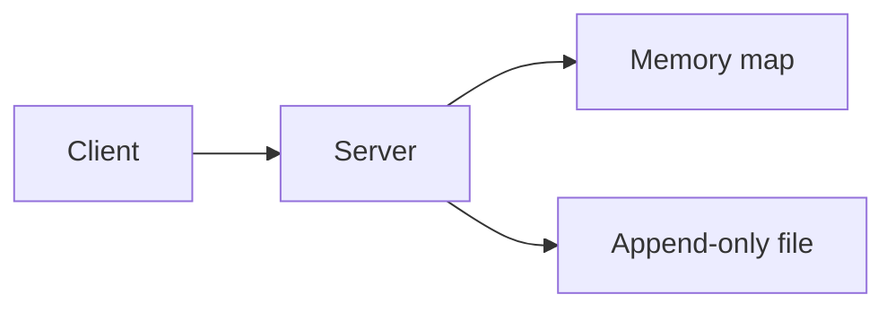
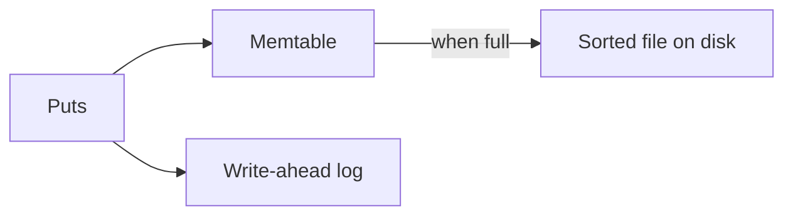
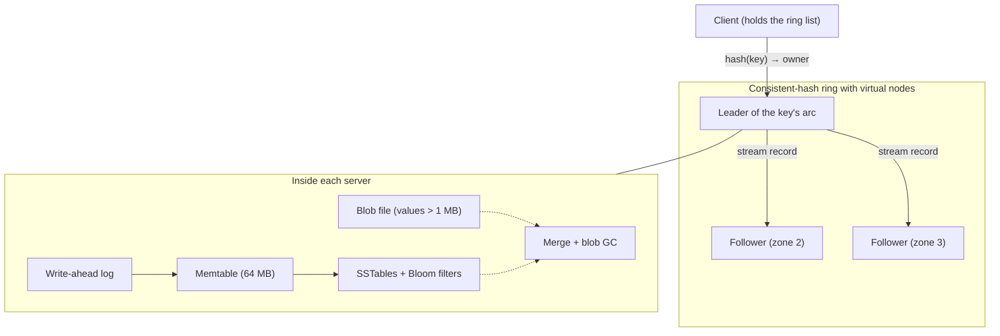

# Key-value store system design — handoff

**Status: LOCKED through Deep dive 7 (large values) and the final architecture wrap-up. All deep dives are decided.**

**Do not edit, append, rewrite, rename, or delete this file unless Nabajyoti explicitly gives permission in the current request to update this handoff.** Reading it and continuing the interview in chat are allowed. New decisions stay in the conversation until Nabajyoti gives that permission.

Interview target: Senior Software Engineer, LinkedIn-style, 45 minutes. Use a Hello Interview progression: naive, then better, then interview-ready. Proceed one step at a time and do not dump the complete design.

Speak in simple English. Avoid punchy wording.

---

## Where we are

| Phase | Step | State |
| --- | --- | --- |
| 0 | Understand the question | Locked |
| 1 | Functional requirements | Locked |
| 1 | Non-functional requirements | Locked |
| 1 | Core entities | Locked |
| 1 | APIs | Locked |
| 2 | Basic working system | Locked. Naive baseline. One append-only value file plus a memory map. Meets the functional requirements. Does not meet the scale or availability NFRs. |
| 3 | Deep-dive shortlist | Locked. Four topics. |
| 3 | Deep dive 1 — one-machine LSM store | Locked. Write-ahead log, memtable, sorted files, merge, and crash recovery. |
| 3 | Deep dive 2 — which machine owns a key | Locked. Consistent hashing with virtual nodes, and moving keys into the new server’s LSM store. |
| 3 | Deep dive 3 — copies, and when a put succeeds | Locked. Three copies, leader plus two followers. Success after two of three have the record. |
| 3 | Deep dive 4 — one very busy key | Locked. Gets use any copy. The writer passes `min_version`. Puts of one opaque key stay on the leader. |
| 3 | Deep dive 5 — read path and Bloom filters | Locked. One Bloom filter per sorted file, in memory. Missing-key gets skip the disk. |
| 3 | Deep dive 6 — TTL | Locked. One `expires_at` fixed by the leader. Expired records are tombstones at merge and flush, with a clock-skew margin. Fully-expired files are dropped whole. |
| 3 | Deep dive 7 — values up to 2 GB | Locked. Value separation into a per-server blob file, chunked direct streaming to the leader, and pointer-guided blob GC. No Kafka. |
| Final | Full architecture and interview probe list | Locked |

**Next chat step:** No required deep dive remains. Continue only with a recap, interview practice (`challenge me`), or an optional follow-up that Nabajyoti requests. `next` alone does not open a new topic. Do not reopen deep dives 1 through 7.

---

## Coaching rules

- Never give the complete design in one response.
- Move exactly one step when Nabajyoti says `next`.
- If Nabajyoti asks a question, answer only that question and do not advance automatically.
- Keep replies concise, normally about 150–250 words.
- Use simple English.
- Introduce at most one or two new technical concepts per deep-dive response.
- Evolve the same system: naive → better → interview-ready.
- For every improvement, state what is wrong, why it matters, the simplest fix, and the trade-off.
- Optimize for a defensible Senior SWE design in a 45-minute interview, not maximum sophistication.
- Do not introduce a technology because it is popular.
- The storage engine on each machine is the LSM store from deep dive 1. Do not switch it back to a hash map over one value file, and do not resume the milestone rewrite as the main path.
- Replication is the three-copy leader group from deep dive 3. Do not switch it to leaderless replication, and do not acknowledge a put from the leader’s disk alone.
- A hot key follows deep dive 4. Do not send every get back to the leader only. Do not split one opaque value across leaders.
- TTL follows deep dive 6. Do not add per-key timers or a separate expiry service.
- Large values follow deep dive 7. Do not put a Kafka chunk queue between the client and the store, and do not store 2 GB values inside the LSM.
- Commands such as `next`, `recap`, `deeper`, or `interview answer` are not permission to modify this file.

Commands retain their agreed meanings: `next`, `deeper`, `simplify`, `why`, `alternatives`, `interview answer`, `recap`, `big picture`, `skip`, and `challenge me`.

---

## Question in plain language

Design a durable key-value store. A client puts a value under a key, gets it back, or deletes it.

Start on one machine. The disk rules are part of the problem:

- The values do not fit in memory.
- A write may only append to a file.
- A read may use any offset in the file.
- A write may not overwrite the middle of a file.

A write adds a new record. A read must still find the latest value for that key. After a crash, a write that was called successful must still be there.

The same question shows up in three forms:

1. **Single machine, append-only file.** Answered by the naive baseline, then replaced as the main design by the LSM store in deep dive 1.
2. **Durability and recovery.** Answered inside deep dive 1: log flush before acknowledgement, temporary file plus rename, and replay of the log.
3. **Many machines.** Ownership and key movement are locked in deep dive 2. Copies and write acknowledgement are locked in deep dive 3. One very busy key is locked in deep dive 4.

The LinkedIn-style target from Nabajyoti’s notes is a highly available distributed store at about 1 million requests per second, half reads and half writes. Defend one concrete design, including what a successful write means. Do not list every database technique.

### System boundary

**In scope.** Put, get, and delete for one key. An LSM store on each machine. Hash-based placement, key movement, three copies per arc, and a very busy key are locked.

**Out of scope for the core design.** Reading keys in sorted order. Changing part of a value. A transaction across several keys. Search, secondary indexes, and SQL. Accounts and permissions. Several regions at once. TTL, unless the interviewer asks. Blob storage for large values, unless the interviewer asks about a value near the 2 GB maximum. Bloom filters, unless Nabajyoti asks to continue deep dive 1.

### Central engineering challenge

Fast lookup of the latest value, with durable append-only writes, first on one machine and then across machines.

### Default path

Stay on one path. Each machine runs the locked LSM store. Across machines, use hash-based placement and one leader per group of three copies. A put succeeds only after two of the three have the record. The details are locked in deep dive 3. A get may use any of the three copies. The client that just wrote passes `min_version`. Puts of one opaque key stay on that leader. The details are locked in deep dive 4. Range splits, leaderless copies, and B-trees are short comparisons only if the interviewer asks. Do not mix replication models.

An LSM store was chosen over a memory map of file offsets because the interviewer will probe a write-ahead log, a memtable, sorted files, compaction, and crash recovery. The keys are assumed to fit in the structures LSM already keeps. Scans are out of scope, so sorted files exist for the LSM write path, not to serve range reads.

---

## Locked functional requirements

A client saves a value under a key and reads it back later. The store treats the key and the value as opaque bytes.

1. **Put.** Save a value for a key. If that key already exists, the new value replaces the old one.
2. **Get.** Return the current value for a key. If the key does not exist, say so.
3. **Delete.** Remove a key. A later get reports that the key does not exist.

Each call touches one key.

---

## Locked non-functional requirements

1. **Throughput.** About 1 million requests per second. Half are gets, half are puts. Deletes are rare and count as writes. The average value is about 10 KB, so puts move about 5 GB of user data per second. Many puts update keys that already exist. The live data is larger than the memory of one machine. A single value may be as large as 2 GB, but that maximum is not the design point. The request rate and the maximum size are separate facts. Both cannot apply to every call at once.
2. **Durability.** If put returns success, that value is still present after the process or the machine crashes. A put that has not yet been called successful may disappear.
3. **Availability.** Gets and puts continue when one machine is down. The keys owned by a leader that just died may pause for a few seconds while another copy takes over. Copies sit in different zones inside one region.
4. **Single-key consistency.** After a successful put, a later get of that same key returns the new value. The guarantee applies to one key.

A typical get or put should finish in tens of milliseconds. Microsecond latency is not a requirement.

**Large values.** Do not store the common 10 KB values in S3 or similar blob storage. That misses the append-only log this interview asks for, and it is a poor fit for 1 million small requests per second. If asked about a value near 2 GB, the store keeps a small record with a pointer, and the big bytes go to blob storage. Multipart upload is only for that large object.

---

## Locked core entities

### Record

One saved version of one key.

- **key** — the lookup id. Opaque bytes.
- **value** — the bytes stored for that key. About 10 KB in the common case.
- **version** — a number that increases every time this key is put or deleted. The highest version is the current one.
- **deleted** — set when this version removes the key. The value is empty. A later get says the key is missing.

A put or a delete adds a new record with the next version. It leaves the older records in place. A get uses the record with the highest version for that key.

There is no user table and no secondary data. Which machine holds a key is a routing rule, not a stored entity yet.

---

## Locked APIs

Three calls. A client library can expose the same three methods. HTTP is a fine way to describe them.

### Put

`PUT /v1/keys/{key}`

- Request: the value bytes in the body.
- Response: the new version.

### Get

`GET /v1/keys/{key}`

- Request: the key. Optional `min_version`, sent by the client that just received a version from put or delete.
- Response: the value and its version.
- If the key was never written, or the latest record is a delete, the response says the key was not found.
- A follower answers a get with `min_version` only when it has that version or a newer one. Otherwise the client asks the leader. Deep dive 4 locks this.

### Delete

`DELETE /v1/keys/{key}`

- Request: the key.
- Response: the version of that delete.

The version returned by put and delete is the acknowledgement. After the client receives it, that write must survive a crash, and a later get of the same key must return that result.

Auth, pagination, and a long list of error codes are out of the design.

---

## Locked basic system

This is the naive baseline. Deep dive 1 replaces it as the storage engine. Keep it in the interview only as the starting point.

One server. The append-only file is the source of truth. A memory map remembers where the latest record for each key sits. The map stores the key, file offset, length, version, and deleted flag. It does not store the value.

**Put.** Append one record: version, deleted = false, key, and value. Flush that record to disk. Update the map. Return the version.

**Get.** Look up the key in the map. If the key is absent or deleted, return not found. Otherwise read the value at that offset.

**Delete.** Append a record with deleted = true and an empty value. Flush it. Update the map. Return the version.

**Restart.** The map is empty. Read the file from the beginning and fill the map again. Skip a partial record at the end of the file.

**Why it was not enough.** This server cannot carry 1 million requests per second. If it dies, the service stops. The file keeps every old version. A flush on every write is slow. Startup must read the whole file. A concrete failure: 1 million live keys at about 10 KB is about 10 GB of current data. Updating those same keys 100 times grows the file to about 1 TB, and startup reads the full 1 TB.

A milestone rewrite of that one file was discussed and set aside. Do not teach it as the main design.

---

## Locked deep dive 1 — one-machine LSM store

**Original bottleneck.** The value file keeps every old record, every put flushes that file, and startup rereads the whole file.

**Decision.** Store data in an LSM engine: a write-ahead log, a memtable, and sorted files on disk. This is the path the interviewer will probe.

**Put and delete.** Append the record to the write-ahead log and store the latest record for that key in the memtable. Many puts share one flush of the log. Return the version only after that flush includes this record. A put that is still waiting for its flush was never called successful, so a crash may drop it. New puts do not go into the old value file. A delete is a normal record with deleted set.

**Memtable flush.** When the memtable reaches about 64 MB, seal it. Further puts go to a fresh memtable and keep appending to the log. A background step writes the sealed memtable to a new file, sorted by key. That file is an SSTable. Write it under a temporary name, flush it, then rename it into place. After the rename, drop the log records covered by that file.

**Get.** Check the active memtable, then any sealed memtable that is still being written, then the sorted files from newest to oldest. The first match wins. A deleted record means the key was not found.

**Merge.** A background merge reads a batch of sorted files in key order and writes one new sorted file. When the same key appears more than once, keep the record with the highest version. Write that file under a temporary name, flush it, and rename it. Delete the input files only after the rename. If the highest version is a delete, and this merge includes every file that could still hold the key, leave the key out of the new file. If an older file stays outside the merge, copy the delete record into the result. Otherwise that older file would make the key visible again.

**Crash.** Ignore a temporary file. Replay the log into a new memtable. Sorted files that were renamed stay as they are.

**Trade-off.** Live data is rewritten during a merge, and the old files plus the new file both use disk space while the merge runs. A get for a key that is absent can still open every remaining file. One machine still cannot take about 5 GB of writes per second. If this machine dies, the service stops.

**Left out on purpose.** Bloom filters. The 2 GB blob-storage pointer. Leveled compaction as a separate design. Those stay closed unless Nabajyoti asks.

---

## Locked deep dive 2 — which machine owns a key

**Original bottleneck.** One server cannot take about 500,000 puts per second or about 5 GB of new data per second. A simple `hash(key) % N` formula breaks when `N` changes, because almost every key changes owner at once.

**Decision.** Place servers and keys on one consistent-hashing ring, use virtual nodes for each server, and move only the taken arcs into the new server’s LSM store before switching client traffic.

**Ownership and discovery.** Hash a server id to place it on the ring. Hash a key to place that key. Walk clockwise from the key; the first server you meet owns it. The client keeps the sorted list of server positions, finds the owner locally, and sends the put, get, or delete there. Each physical server is placed at many points on the ring (virtual nodes, such as `A-1`, `A-2`). That keeps the arcs short, spreads load evenly, and lets a new server take a small share from several existing servers instead of one neighbor.

**Adding a server and moving keys.** Suppose `A` is at 10, `B` at 40, and `C` at 70, so `C` owns hashes 41 through 70. `D` joins at 60 and will take hashes 41 through 60 from `C`, while `C` keeps 61 through 70.

1. **Start copying.** Clients still use the old ring, so calls for 41 through 70 keep going to `C`. `C` walks its store, hashes each key, and streams only the keys in 41 through 60 to `D`.
2. **Traffic continues on the old owner.** While `C` copies, a new put or get for a key in 41 through 60 still goes to `C`. `C` writes the new version and remembers that this key changed after the copy started.
3. **Catch up and switch.** When the pass finishes, `C` briefly holds new puts for 41 through 60, sends any records that changed during the copy to `D`, and waits for `D` to confirm. Then the ring list updates to include `D` at 60. If a client with a slightly stale list still calls `C`, `C` sees `D` is the owner and either forwards the call or tells the client to refresh.
4. **Clean up.** `C` drops the handed-off keys during its later LSM merges.

**How records are written on the new server.** `C` does not call the public client `put(key, value)` one key at a time. It sends batches of full records—key, value, existing version, and deleted flag—so version numbers and tombstones are preserved. `D` writes each batch through its normal LSM path (write-ahead log and memtable, flushed once per batch). If a key arrives twice because it changed during step 2, `D`’s LSM store keeps the higher version and drops the older one during merge.

**Trade-off.** The LSM files are sorted by key, while the ring is ordered by key hash, so `C` has to check its keys during a join. Joining is rare, so that background pass is acceptable. Key movement still runs from the current leader of the arc. If that leader’s disk is lost, deep dive 3 supplies a follower that already has the acknowledged records.

---

## Locked deep dive 3 — copies, and when a put succeeds

**Original bottleneck.** Each key lived on one server. A successful put existed only in that server’s log. If that machine’s disk was lost, the value was gone. In the concrete case, key `user:42` was owned by server C. C flushed version 7 and returned success. When C died, no other server had version 7, and a new server on the ring could not rebuild it.

**Decision.** Keep one replication model. Each arc has three copies, in different zones. The ring owner is the leader. Two other servers are followers. Each of the three runs the LSM store for that arc. Leaderless copies stay a short comparison only if the interviewer asks.

**When a put or delete succeeds.** The client sends it to the leader. The leader appends the record to its own log and sends that same record to both followers. It returns the version only after its own log and at least one follower’s log contain the record. That is two of the three copies. In this dive, a get went to the leader so that later get returned the acknowledged version. Deep dive 4 changes where a get is served.

**When the leader dies.** If the client never received a version, it tries the other two copies and sends the put again. The record may already be on a follower, or it may be missing. Both are acceptable, because the client never heard success. If the client did receive the version, at least one follower has the record. The two survivors compare logs. The one with the later log becomes leader only with the other survivor’s agreement. It copies anything missing onto that follower, then serves. The pause is a few seconds. If two of the three copies are down, puts for that arc wait.

**Raft.** Replicas were not already running before this dive. The locked rule is the same commit rule Raft uses: acknowledge only after a majority, and choose the next leader from copies that already have every acknowledged record. Saying “Raft” is fine if the interviewer asks. Do not replace this group with leaderless replication.

**Trade-off.** A put waits for one other machine. Disk use is about three times the live data. Writes for an arc pause for a few seconds when the leader dies, and they wait if two copies are down.

---

## Locked deep dive 4 — one very busy key

**Original bottleneck.** The ring balances keys, not requests. One key has one leader. In the concrete case, the store handles 1 million requests per second and `session:hot` takes 30% of them. That is about 300,000 requests per second, all sent to one leader. At about 10 KB a value, that is about 3 GB per second through that machine, before each put is also copied to a follower. Virtual nodes do not move part of one key. Followers did not answer gets.

**Decision.** Leave puts and deletes on the leader. Let a get use the leader or either follower. A normal get may use any copy. The client that just received a version sends it as `min_version` on the next get. A follower answers only when it has that version or a newer one. If it does not, the client asks the leader.

**Reads.** Three copies are enough for the gets. A 10 KB value stays in memory, so those gets are a network load. Spread over three machines, about 300,000 gets per second is about 1 GB per second each, which one server can send. The client that passes `min_version` sees its own write. Other readers can be one version behind, because the leader waits for only one follower.

**Writes.** Puts of one key stay on the leader. The store has no way to split an opaque value and merge it later. About 150,000 puts per second of `session:hot` is about 1.5 GB per second into one log. That is the ceiling for this key. If the client can write independent pieces, such as `session:hot#0` through `session:hot#9`, those pieces hash to different leaders. A counter can be added back together. A single value that replaces itself cannot.

**What to say.** Reads of a hot key use all three copies. The writer sends the version it received, so its next read is fresh. Writes of one opaque key stay on the leader. Past that leader’s write rate, the client has to split the key.

**Trade-off.** Readers who omit `min_version` can see the previous version. One unsplittable key cannot exceed one leader.

---

## Locked deep dive 5 — read path and Bloom filters

**Original bottleneck.** A get checks the active memtable, then the sealed memtable, then sorted files newest to oldest. For a key that exists, this is fast. For a key that does not exist, the get must open every sorted file on disk before it can say "not found." A crawler asking for 50,000 never-written keys per second forces a disk read per file per key, and slows real gets.

**Decision.** Give each sorted file a Bloom filter, kept in memory. The filter answers only "definitely not here" or "maybe here." On a get, ask each file’s filter. If it says "definitely not here," skip that file with no disk read. If it says "maybe here," open the file and check.

**Read path.**

1. Active memtable. Most hits for existing keys stop here.
2. Sealed memtable still being written.
3. Each sorted file, newest to oldest: Bloom filter first. Skip the file if it says "definitely not here." Open it only on "maybe here." First match wins.

For an existing key: memory lookup plus usually one disk read. For a missing key: no disk reads in the normal case. A rare false positive costs one extra disk read, which is fine.

**Correctness with deletes.** A `deleted` record is a record, so its key is in the filter. The get finds the tombstone and returns "not found" correctly.

**Scope.** The filter is local to one sorted file on one copy. It does not change the log, the memtable, the merge, or leader-follower replication. It only skips files that provably do not have the key.

**Trade-off.** About one byte of memory per key in the file, and a small false-positive rate, in exchange for removing nearly all disk reads for missing keys. This is sufficient for the NFRs. No further read-path machinery is needed.

**What to say in the interview.** "The memtable handles recent writes. For anything older, each sorted file has a Bloom filter in memory. It lets us skip any file that definitely does not contain the key, so a read for a missing key costs no disk reads, and a read for an existing key costs about one. We trade a little memory per key and a small false-positive rate for a large drop in disk reads."

---

## Locked clarification — where SSTables live, and how storage scales

Asked and answered after the full-design diagram. Locked as part of the design.

- **SSTables are files on the local disk of that server.** Each server (leader and each follower) has its own disk, its own write-ahead log, its own memtable, and its own SSTables. Disks are not shared.
- **SSTables are never sent over the network.** The leader sends the record (key, value, version, deleted). Each follower rebuilds its own log, memtable, and SSTables from that stream.
- **S3 is not in the read or write path.** Serving a get from object storage adds a network round trip per file and misses the storage engine this interview asks for. Copying SSTables to S3 in the background is an optional extra backup, not the primary store.
- **Memory is not the data limit.** RAM holds the memtable and caches. Disk holds the SSTables. Each server’s data may be far larger than its own RAM.
- **Scaling storage means adding servers, not adding disks to one server.** A new server takes a small arc of the ring and gets its own disk and LSM store. Example: 20 TB of live data over ten servers is about 2 TB each. Adding disks to one machine only delays the day a new server is needed. It does not remove the per-machine limit.

## Locked deep dive 6 — TTL

**Original bottleneck.** The naive fix stores `expires_at` on the record and checks it only on read. Reads are correct, but nothing ever removes the dead data. Concrete case: 1 million puts per second, each with a 60-second TTL. About 60 million keys are live at any moment, yet an hour of writes leaves 3.6 billion keys’ worth of records on disk until merges happen to pass over them.

**Decision.** Expiry rides on work the LSM already does. No timers, no new background jobs.

- **One clock decides.** The leader converts the client’s TTL to an absolute time once: `expires_at = leader_now + ttl`. That number is stored in the record. Followers copy the record as-is and never recompute it. Reads and merges only compare against the stored number.
- **Expired record equals tombstone.** At memtable flush and at merge, a record whose expiry has passed is treated exactly like the locked delete rule: leave the key out if this merge covers every file that could still hold it; otherwise copy the expired record forward as a marker. The marker stops an older, live-looking version in a file outside the merge from coming back after the newer version expired.
- **Clock-skew margin.** Clocks can differ by a few seconds, so the merge drops a record only when `expires_at + margin < now`, with the margin (about 10 seconds) larger than the worst expected skew. Expiry may happen late, never early. Disk space is reclaimed a little late; correctness is never at risk. Reads are best-effort on the late side, matching real systems such as Redis and Cassandra.
- **Whole-file drop.** Each sorted file records the largest `expires_at` it contains. If `max_expires_at + margin < now`, every record in the file is dead, so the file is deleted without being read or merged. TTL-heavy workloads, where whole files die at once, are cleaned at the cost of one file delete. Mixed-lifetime files still use the normal merge path.
- **API.** `PUT /v1/keys/{key}?ttl=60`. No TTL means the record never expires. This is the default for everything locked before this dive.

**Trade-off.** Space comes back when a file merges or expires as a whole, not at the exact second of expiry.

**What to say in the interview.** "The leader fixes one absolute expiry at write time, so only one clock ever decides. Expired records are treated like deletes by the flush and merge we already have, with a safety margin so clock skew can only expire late, never early. Files whose newest possible expiry has passed are dropped whole. The contract is: a key lives at least as long as its TTL."

## Locked deep dive 7 — values up to 2 GB

**Original bottleneck.** The naive approach runs a 2 GB value through the same locked path as a 10 KB value: write-ahead log, memtable, sorted file, merge, and a full record streamed to both followers. It is correct but slow everywhere at once. The 64 MB memtable cannot hold it. A key updated 100 times pushes about 200 GB through the log and merge path. Each put streams 2 GB to two followers and the client waits for one follower to flush it. Concrete case: `model:latest`, a 2 GB file republished 100 times a day, costs about 200 GB of disk rewrite and 400 GB of network daily for one key.

**Decision.** Value separation plus chunked direct streaming. Two write paths, one store.

- **Value separation.** Values below about 1 MB stay in the LSM exactly as locked. Larger values go into a separate append-only blob file on the same server. The LSM record holds only a pointer: which blob file, offset, length, and a checksum. The memtable and merge now handle a few dozen bytes per large value. Dead copies from overwrites sit in old blob files, untouched by merges.
- **Chunked direct streaming.** No client sends 2 GB in one request. The client streams the value in chunks (larger than 500 KB; think 8–64 MB), in order, straight to the leader over a resumable connection. The leader appends each chunk to its blob file and forwards it to the two followers. After the last chunk, it writes the pointer record into the LSM, and only then returns success. The two-of-three acknowledgement rule is unchanged. An upload that dies halfway leaves an unreferenced blob: harmless garbage. If the leader dies mid-upload, the client resumes from the last confirmed chunk against the new leader; chunk offsets make retries safe.
- **Rate limit.** Large-value writes are rate-limited to a few hundred per second across the cluster. This is what makes streaming each value to two followers acceptable. A Kafka chunk queue was proposed and rejected: it breaks chunk ordering across workers, changes what the acknowledgement means (Kafka success is not store success), and at 500 KB chunks recreates the million-tiny-writes problem.
- **Blob garbage collection.** Merges never touch blob files, so a background pass reclaims them. Walk the LSM and collect every live pointer (pointers are small). For each old blob file, measure how many bytes are still referenced. If a file is mostly dead, copy its live blobs into a fresh file using the same temp-name, flush, rename discipline as SSTables, write updated pointer records into the LSM, then delete the old file. Anything unreferenced is dead: superseded versions, deleted keys, and chunks from uploads that never finished. One pass collects all three.
- **Failure handling.** The pointer record is written only after the last chunk is flushed on two of three copies. A crash before that can only produce garbage, never a dangling pointer. A torn blob is caught by its checksum.
- **Read path.** Get reads the record as usual. A pointer record costs one extra disk touch to fetch the blob.

**Trade-off.** Two write paths and one more background job, in exchange for the LSM never touching a payload.

**What to say in the interview.** "Small values stay in the LSM. Large ones are streamed in chunks straight to the leader, land in an append-only blob file on each of the three copies, and the record just points at the bytes. Success still means two of three copies have it. Dead blobs are reclaimed by a background pass that walks the live pointers, rewrites mostly-dead files, and never touches the LSM merge path."

---

## Locked final architecture

One system, three layers. Routing decides which machine. Replication keeps the data alive. The LSM keeps it durable on each machine. TTL, large values, and hot keys are small additions on top.

**One put, end to end.** The client hashes the key and finds the leader from its ring list. The leader appends to its write-ahead log, forwards the record to both followers, and returns the version once two of three logs have it. Later the memtable flushes to an SSTable. Merges drop old versions, tombstones, and expired records. Blob GC drops dead large values.

**One get.** Any of the three copies can answer. Memtable first, then Bloom filters skip files that cannot hold the key. Usually one disk read. The writer passes `min_version` so it never reads its own write stale. A pointer record costs one extra disk touch for a large value.

**What the interviewer will probe, in order of likelihood.**

1. **Durability of a write.** WAL flush before ack, many puts sharing one flush, replay after a crash. The heart of the interview.
2. **The acknowledgement rule.** Why two of three. What happens when the leader dies mid-write. Why a lost acknowledged write is impossible.
3. **The single-machine engine.** Memtable, SSTables, merge, temp-file plus rename. Bonus: Bloom filters for missing keys.
4. **Key placement.** Why consistent hashing beats `hash % N`, what virtual nodes buy, how keys move when a server joins without stopping traffic.
5. **Reads after writes.** `min_version` and reading from followers. The consistency story.
6. **The extras, if time allows.** Hot key on three copies. TTL with one clock and a skew margin. Large values with blob separation, chunked streaming, and GC.

**Through-line.** Every mechanism reuses something already in the design. TTL rides the merge. Blob GC rides the pointer scan. Hot keys ride the replicas the store already keeps.

## Not decided yet

Nothing. All seven deep dives and the final architecture are locked. Continue only with recaps, interview practice, or optional follow-ups Nabajyoti requests.
