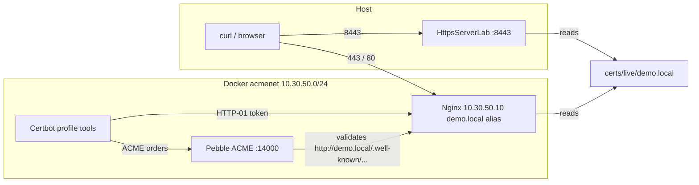

# HTTPS Lab — Technical Details

Step-by-step reference for running a local HTTPS stack with **ACME** (Automated Certificate Management Environment), **Pebble** (Let's Encrypt's test CA), **Nginx**, **Certbot**, and a **from-scratch Java TLS server** with hot certificate reload.

**Lab directory:** `projects/system-design-arpit-bh/src/main/java/com/nabajyoti/systemdesign/week3/httpslab/`

---

## Prerequisites

- Docker Desktop (or Docker Engine + Compose v2)
- macOS or Linux host (commands below use macOS keychain optional step)
- JDK 11+ (for the Java server; run from IntelliJ or Gradle with **working directory** set to this `httpslab/` folder)
- `curl`, `openssl` on the host

Add a fake hostname:

```text
127.0.0.1   demo.local
```

Edit `/etc/hosts` as root.

---

## What you are building

| Component | Role |
|-----------|------|
| **Pebble** | Local ACME CA (simulates Let's Encrypt) |
| **Nginx** | Serves HTTP (port 80) for ACME HTTP-01, HTTPS (443) with issued certs |
| **Certbot** | ACME client; obtains and renews certs into `./certs` |
| **HttpsServerLab.java** | Minimal JDK `HttpsServer` on **8443**; loads the same PEM files; hot-reloads on file change |



**Network note:** Pebble validates HTTP-01 by reaching `http://demo.local:80/...` from inside Docker. Nginx has network alias `demo.local` at `10.30.50.10`, so the challenge resolves without a separate DNS mock server.

**Design deviation:** The original plan used `pebble-challtestsrv`. That image failed when started with a wrong command (`invalid command line arguments`). This lab uses the Nginx alias instead. Do not re-enable challtestsrv unless you pass flags-only, e.g. `["-defaultIPv6", "", "-defaultIPv4", "10.30.50.10"]`.

---

## Directory layout

```text
httpslab/
├── docker-compose.yml
├── renew.sh
├── technical-details.md          # this file
├── HttpsServerLab.java
├── .gitignore                    # ignores certs/ and www/.well-known/
├── pebble/
│   └── pebble-config.json
├── nginx/
│   └── default.conf
├── www/
│   └── index.html
└── certs/                        # created by certbot; gitignored
    ├── pebble-root.pem           # download locally; do not commit private material
    ├── live/demo.local/          # symlinks → archive/
    ├── archive/demo.local/
    ├── accounts/
    └── renewal/demo.local.conf
```

**Git policy:** Commit compose, nginx, pebble config, scripts, and Java source. **Never commit** `certs/` (keys, accounts, issued certs) or `www/.well-known/` (challenge tokens).

---

## Step 1 — Lab setup and ACME basics

### Concepts

- **ACME:** Protocol clients use to prove domain control and receive X.509 certificates from a CA.
- **Let's Encrypt** cannot sign arbitrary names like `localhost` for public trust; you need a real public DNS name. **Pebble** is LE's local test CA with the same protocol, untrusted root.
- **HTTP-01:** CA asks the client to place a token at `http://<domain>/.well-known/acme-challenge/<token>`. Port **80** must serve that path before TLS can be automated.

### Start infrastructure

From `httpslab/`:

```bash
docker compose up -d pebble nginx
```

Verify Pebble directory (ignore TLS verify for Pebble's own cert):

```bash
curl -k https://localhost:14000/dir
```

**Pebble endpoints (host):**

- ACME: `https://localhost:14000/dir` (inside Compose: `https://pebble:14000/dir`)
- Management (root download): `https://localhost:15000/roots/0`

**Fixed IPs on `acmenet`:**

- Pebble: `10.30.50.2`
- Nginx: `10.30.50.10` (alias `demo.local`)

---

## Step 2 — Plain HTTP Nginx

Nginx serves static content from `./www` on port 80. Config: `nginx/default.conf` — challenge path on 80; other paths redirect to HTTPS once TLS is configured (after step 3).

Test:

```bash
curl -H "Host: demo.local" http://127.0.0.1/
# or after /etc/hosts:
curl http://demo.local/
```

---

## Step 3 — Issue a certificate (HTTP-01)

Run Certbot via the `tools` profile (one-shot container):

```bash
docker compose run --rm certbot certonly \
  --webroot -w /var/www/html \
  -d demo.local \
  --server https://pebble:14000/dir \
  --no-verify-ssl \
  --agree-tos \
  --register-unsafely-without-email \
  --non-interactive
```

Certbot writes:

- Versioned files: `certs/archive/demo.local/cert1.pem`, `chain1.pem`, `fullchain1.pem`, `privkey1.pem`
- Stable symlinks: `certs/live/demo.local/{cert,chain,fullchain,privkey}.pem`

Nginx already points at:

```nginx
ssl_certificate     /etc/letsencrypt/live/demo.local/fullchain.pem;
ssl_certificate_key /etc/letsencrypt/live/demo.local/privkey.pem;
```

(`./certs` is mounted at `/etc/letsencrypt` in the Nginx container.)

Reload Nginx if it was up before the cert existed:

```bash
docker compose exec nginx nginx -s reload
```

Inspect the leaf cert:

```bash
openssl x509 -in certs/live/demo.local/cert.pem -noout -text | head -30
```

Test HTTPS (will fail trust until step 4):

```bash
curl -k https://demo.local/
```

### Pebble account gotcha

Pebble stores ACME **accounts in memory only**. After `docker compose down` or recreating the Pebble container:

```bash
rm -rf certs/accounts
```

Then run `certonly` again (registers a new account). Otherwise: `Account ... not found`.

---

## Step 4 — Trust Pebble's root CA locally

The server sends **leaf + intermediate** (`fullchain.pem`). The **root** is not sent; the client must already trust it.

Download Pebble's current root (bootstrap with `-k` once):

```bash
curl -k https://localhost:15000/roots/0 -o certs/pebble-root.pem
openssl x509 -in certs/pebble-root.pem -noout -subject -issuer
```

Issuer and subject should match (self-signed root).

Verify chain manually:

```bash
openssl verify -CAfile certs/pebble-root.pem \
  -untrusted certs/live/demo.local/chain.pem \
  certs/live/demo.local/cert.pem
```

Use **`chain.pem` / `cert.pem`** under `live/` (not `chain1.pem` — those names live under `archive/`).

Test with curl:

```bash
curl --cacert certs/pebble-root.pem https://demo.local/
```

Optional — trust in macOS system keychain (browsers):

```bash
sudo security add-trusted-cert -d -r trustRoot \
  -k /Library/Keychains/System.keychain certs/pebble-root.pem
```

Remove lab roots from Keychain Access when finished (search "Pebble").

**Root regeneration gotcha:** Pebble creates a **new CA hierarchy on every container start**. After `docker compose up -d --force-recreate pebble`, re-download `pebble-root.pem` and re-trust if you imported to the keychain. Issued certs under `certs/` may also need re-issuance against the new CA.

---

## Step 5 — Short lifetimes, renewal, Nginx reload

### Pebble profile (1-hour certs)

In `pebble/pebble-config.json`, use **`profiles`**, not the deprecated `certificateValidityPeriod` (ignored in Pebble 2.8):

```json
"profiles": {
  "default": {
    "description": "1-hour certs for the rotation lab",
    "validityPeriod": 3600
  }
}
```

Recreate Pebble and confirm logs:

```bash
docker compose up -d --force-recreate pebble
docker compose logs pebble | grep -i profile
# expect: validity period of 3600 seconds
rm -rf certs/accounts
```

Re-issue (existing lineage requires force for a fresh cert):

```bash
docker compose run --rm certbot certonly \
  --webroot -w /var/www/html \
  -d demo.local \
  --server https://pebble:14000/dir \
  --no-verify-ssl \
  --agree-tos \
  --register-unsafely-without-email \
  --non-interactive \
  --force-renewal
```

Check lifetime:

```bash
openssl x509 -in certs/live/demo.local/cert.pem -noout -dates
```

Re-download root if Pebble was recreated, then:

### `renew.sh`

```bash
#!/usr/bin/env bash
set -euo pipefail
cd "$(dirname "$0")"

docker compose run --rm certbot renew --no-verify-ssl
docker compose exec nginx nginx -s reload
```

```bash
chmod +x renew.sh
./renew.sh
```

**Reload vs restart:** `nginx -s reload` (SIGHUP) spawns new workers with updated cert files; old workers drain in-flight requests. Container uptime does not reset.

With 1-hour certs, `certbot renew` treats the cert as always due. For long-lived certs, renewal runs only when within certbot's expiry window unless you use `--force-renewal` on `certonly`.

---

## Step 6 — Prove rotation (client perspective)

Watch **served** serial and HTTP status (Nginx on 443):

```bash
while true; do
  serial=$(echo | openssl s_client -connect demo.local:443 -servername demo.local 2>/dev/null \
    | openssl x509 -noout -serial | cut -d= -f2 | cut -c1-16)
  code=$(curl --cacert certs/pebble-root.pem -s -o /dev/null -w "%{http_code}" https://demo.local/)
  echo "$(date +%T) HTTP $code serial $serial"
  sleep 1
done
```

In another terminal:

```bash
./renew.sh
```

Expect: serial changes shortly after renew completes; HTTP stays `200` every tick.

Compare on-disk vs served if debugging:

```bash
openssl x509 -in certs/live/demo.local/cert.pem -noout -serial
```

---

## Step 7 — Java HTTPS server with hot reload

**File:** `HttpsServerLab.java`  
**Port:** `8443` (avoids binding to 443 without root)  
**Run:** IntelliJ/Gradle with **working directory** = `httpslab/`.

### Part A — Load certbot PEMs into `SSLContext`

Flow: read `fullchain.pem` → in-memory `KeyStore` → `KeyManagerFactory` → `SSLContext` → `HttpsServer` + `HttpsConfigurator`.

Private key: Certbot 2.x often issues **ECDSA** keys (`id-ecPublicKey`). PKCS#8 `privkey.pem` is parsed by trying `RSA` then `EC` in `parsePrivateKey()`.

Verify:

```bash
curl --cacert certs/pebble-root.pem https://demo.local:8443/
echo | openssl s_client -connect demo.local:8443 -servername demo.local 2>/dev/null | openssl x509 -noout -serial
openssl x509 -in certs/live/demo.local/cert.pem -noout -serial
```

Serials should match.

### Part B — Hot reload without restart

- `AtomicReference<SSLContext>` holds the active context.
- `ReloadingConfigurator` overrides `getSSLContext()` and `configure()` so each **new** TLS handshake uses the latest context.
- Daemon thread polls mtimes of `fullchain.pem` and `privkey.pem` every 2s; on change, rebuilds context and `ref.set(...)`. Errors during partial writes are logged; old cert keeps serving.

Prove rotation on **8443** (same watch loop as step 6, but `-connect demo.local:8443` and `https://demo.local:8443/`). Run `./renew.sh` while the Java process stays up; console should log `cert reloaded`.

---

## Troubleshooting quick reference

| Symptom | Likely cause | Fix |
|--------|----------------|-----|
| `Account ... not found` | Pebble recreated; stale `certs/accounts` | `rm -rf certs/accounts`; certonly again |
| Cert still 90 days after config change | Deprecated `certificateValidityPeriod` or old cert not reissued | Use `profiles.validityPeriod`; `--force-renewal` |
| `notBefore` unchanged after certbot | Certbot kept existing cert | `--force-renewal` on `certonly` |
| `unable to get local issuer certificate` with `--cacert` | Stale `pebble-root.pem` after Pebble recreate | Re-download from `:15000/roots/0` |
| `chain1.pem: No such file` | Wrong path | Use `certs/live/demo.local/chain.pem` |
| Java `Invalid RSA private key` / `Version must be 0` | ECDSA key parsed as RSA | Use `parsePrivateKey()` (RSA + EC) |
| HTTP-01 fails | Nginx down or no `demo.local` alias | Check `docker compose ps`; alias on nginx service |

---

## Production mapping (interview notes)

- **ACME + HTTP-01:** Real LE production; port 80 must remain reachable for issuance/renewal unless you use DNS-01.
- **Trust:** Public roots (e.g. ISRG Root X1) ship in OS/browser trust stores; Pebble root is manual, like a private PKI.
- **Rotation automation:** Cron/systemd timer → `certbot renew` → deploy hook → `nginx -s reload` (or in-app reload as in Java).
- **Monitoring:** Probe `:443` (or app port) for expiry and serial changes; alert before expiry, not after.
- **Short lifetimes:** Mitigate weak revocation; force automated renewal pipelines.

---

## Cleanup

```bash
docker compose down
# optional: remove demo.local from /etc/hosts
# remove Pebble roots from macOS Keychain if imported
```

---

## Reference files in this repo

| File | Purpose |
|------|---------|
| [docker-compose.yml](./docker-compose.yml) | Pebble, Nginx, Certbot (tools profile) |
| [pebble/pebble-config.json](./pebble/pebble-config.json) | ACME listen addresses, HTTP-01 ports, 1h profile |
| [nginx/default.conf](./nginx/default.conf) | ACME webroot, TLS paths, redirect |
| [renew.sh](./renew.sh) | Renew + Nginx reload |
| [HttpsServerLab.java](./HttpsServerLab.java) | JDK HTTPS on 8443 with hot reload |
